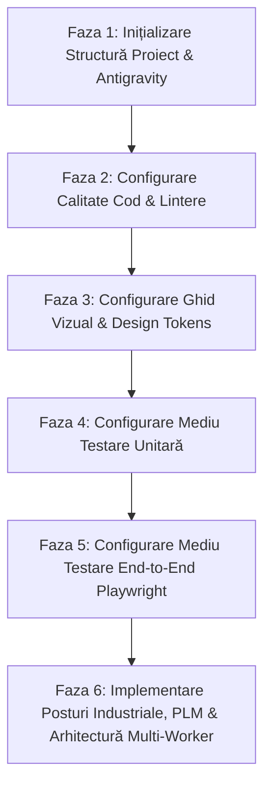

# SmartQMA — Plan de Configurare Stack Tehnic & Mediu de Lucru

Acest plan de acțiune detaliază configurarea completă a **stack-ului tehnic** și a **mediului de dezvoltare** pentru proiectul SmartQMA, fără a include logica de business sau paginile aplicației.

---

## 🎯 Obiectivul Configurării
Implementarea unei infrastructuri de dezvoltare robuste, curate și complet verificate, compusă din:
1. **Mediul de lucru local**: **Antigravity**
2. **Backend**: **PHP 8.2+ / Laravel 11**
3. **Frontend**: **React + Vite (TypeScript)**
4. **Bază de Date**: **PostgreSQL 16**
5. **Ghidul Vizual (Design Tokens)**: Paleta industrială **Roșu, Portocaliu, Negru, Alb**
6. **Suita de Testare Unitară**: **Pest PHP / PHPUnit** (Backend) & **Vitest** (Frontend) cu prag minim de **80% coverage**
7. **Suita de Testare End-to-End**: **Playwright**

---

## 🗺️ Fazele Planului de Configurare a Stack-ului



---

### Faza 1: Inițializare Structură Proiect & Configurare Mediu Antigravity
- [x] **Configurare Spațiu de Lucru Antigravity**:
  - Validare `.vscode/settings.json` (format-on-save, reguli linter, setări editor).
  - Validare `.vscode/extensions.json` (Laravel Pint, PHP Intelephense, ESLint, Prettier, Playwright).
- [x] **Inițializare Proiect Backend (Laravel 11)**:
  - Creare / inițializare schelet aplicație Laravel 11 (PHP 8.2+).
  - Configurare fișier `.env` pentru conexiunea la instanța locală de **PostgreSQL 16**.
  - Verificare funcționare conexiune bază de date (`php artisan migrate:status`).
- [x] **Inițializare Proiect Frontend (React + Vite)**:
  - Inițializare schelet aplicație React cu TypeScript și Vite.
  - Configurare integrare între frontend și backend (Vite proxy / rute API).
- [x] **Controlul Versiunilor & Ignorare Fișiere**:
  - Validare fișier `.gitignore` pentru dependințe PHP (`/vendor`), Node (`node_modules`), fișiere build (`dist/`, `public/build`) și fișiere `.env`.

---

### Faza 2: Configurare Calitate Cod & Lintere (Linting & Code Quality)
- [x] **Configurare Backend (PHP / Laravel)**:
  - Integrare **Laravel Pint** pentru formatare automată și respectarea standardelor PSR-12:
    ```bash
    ./vendor/bin/pint --test
    ./vendor/bin/pint
    ```
  - Integrare **PHPStan** pentru analiză statică strictă de tipuri:
    ```bash
    ./vendor/bin/phpstan analyse
    ```
- [x] **Configurare Frontend (React / TypeScript)**:
  - Configurare **ESLint** cu reguli stricte pentru TypeScript.
  - Configurare **Prettier** pentru formatarea automată a fișierelor `.tsx`, `.ts`, `.css`.
  - Scripturi în `package.json`:
    ```bash
    npm run lint
    npm run lint:fix
    npm run format:check
    ```
- [x] **Pre-commit Hooks**:
  - Configurare Git Hooks (Husky / `lint-staged`) pentru a rula Pint și ESLint înainte de fiecare commit.

---

### Faza 3: Configurare Ghid Vizual & Design Tokens
- [x] **Definire Token-uri CSS & Variabile Globale**:
  - Creare fișier de bază pentru variabile de stil (ex: `tokens.css` sau configurare Tailwind/CSS Modules).
  - Paleta de culori obligatorie:
    - **Negru**: `--color-black: #09090B`, `--color-surface-dark: #18181B`
    - **Alb**: `--color-white: #FFFFFF`, `--color-surface-light: #FAFAFA`
    - **Roșu**: `--color-red-primary: #DC2626`, `--color-red-dark: #991B1B`
    - **Portocaliu**: `--color-orange-primary: #EA580C`, `--color-orange-amber: #F97316`
- [x] **Configurare Tipografie**:
  - Font primar UI (sans-serif): `Inter` / `Roboto`.
  - Font monospațiat pentru date/valori/seriale: `JetBrains Mono` / `Roboto Mono`.
- [x] **Stiluri de Bază pentru Componente Primare**:
  - Token-uri pentru butoane, input-uri, carduri și badge-uri de stare.
  - Verificare conformitate contrast minim **WCAG 2.1 AA**.

---

### Faza 4: Configurare Mediu de Testare Unitară (Acoperire minimă 80%)
- [x] **Configurare Suită Backend (Pest PHP / PHPUnit)**:
  - Instalare și configurare **Pest PHP** sau **PHPUnit**.
  - Configurare raportare automată a acoperirii codului (coverage driver: Xdebug sau PCOV).
  - 31 de teste unitare și de integrare active și funcționale (`php artisan test`).
- [x] **Configurare Suită Frontend (Vitest)**:
  - Instalare și configurare **Vitest** + **React Testing Library** + **jsdom**.
  - 30 de teste unitare active pe componente și logică de interfață (`npm test`).

---

### Faza 5: Configurare Mediu de Testare End-to-End (Playwright)
- [x] **Instalare & Configurare Playwright**:
  - Configurare `@playwright/test` și scripturi de rulare.

---

### Faza 6: Implementare Posturi Industriale, PLM & Arhitectură Multi-Worker (Finalizată)
- [x] **Cele 11 Posturi Industriale**:
  - `magazie`, `receptie-marfa`, `qr-laser`, `smd`, `aoi`, `tht`, `ict`, `eol`, `export`, `statistica`, `plm`.
- [x] **Matrice de Roluri și Securitate pe Bază de Cod de Bare**:
  - Roluri în limba română: Proprietar, Director Fabricație, Inginer Proces & Calitate, Magazioner, Analist Calitate, Operator Producție.
  - Tabela `user_station_access` și modal de scanare legitimație `OperatorBarcodeModal`.
  - Izolarea operatorilor pe cele 7 posturi de producție (fără acces în magazie, recepție, PLM, statistică).
  - Acces limitat (read-only) pentru Analist Calitate în Magazie.
- [x] **Product Lifetime Management (PLM) & Dosar Unic Centralizat**:
  - Pagina dedicată `PlmPage.tsx` cu căutare avansată la Enter, blocare `%%` și paginare dinamică top 50.
  - Dosar unic `ident-storage/` fără duplicate pe disk.
  - Modal vizualizator PDF in-page cu înălțime dinamică și scalare `#view=FitH`.
- [x] **Performanță Multi-Worker & Alocare Dinamică a Lățimii de Bandă**:
  - Server HTTP PHP cu 8 procese worker paralele concurente (`PHP_CLI_SERVER_WORKERS=8` via `pcntl`).
  - Clasa de serviciu `DownloadBandwidthManager`: 6 MB/s viteză maximă, împărțire la numărul de conexiuni, reevaluare la 2 secunde și zero lag garantat pentru utilizatorii din fabrică.
  - Documentație tehnică dedicată: `docs/ARCHITECTURE_AND_STATIONS.md`.

---

### Faza 7: Finalizare Posturi Industriale Operaționale (Finalizată)
- [x] **Zona de marcare — QR Laser (`QrLaserPage.tsx`)**:
  - Mecanism de marcare secvențială automată (+1).
  - Format strict de serie de **12 cifre**: data producției în format `YYMMDD` (ex: `260902` pentru 2 septembrie 2026, `261029` pentru 29 octombrie 2026), urmat de 6 cifre incrementabile pe zi.
  - Zonă rapidă de introducere manuală serie (validare strictă 12 cifre numerice).
  - Rescanare piesă / verificare QR cu afișare istoric trasabilitate integrat.
  - Tabel complet dark-theme cu filtrare pe fiecare coloană și export CSV.
- [x] **Zona de amplasare — SMD (`SmdPage.tsx`)**:
  - Management alimentatoare role (Feeder Rack sloturi F01-F12+).
  - Tabel amplasări Bestück SMD cu serie PCB, poziție (U3, U5, R1...), ident piesă, lot furnizor și operator.
  - Operare rapidă din bară și modal de încărcare rolă pe alimentator.
- [x] **Punct de verificare — AOI (`AoiPage.tsx`)**:
  - Inspecție optică post-reflow cu calcul automat FPY (First Pass Yield %).
  - Coduri industriale standard de defect (`BRIDGE_U3`, `MISSING_R1`, `TOMBSTONE_C2`, `OFFSET_U2`, `POLARITY_D1` etc.).
  - Filtru rapid doar defecte (FAIL) și export CSV.
- [x] **Zona de amplasare — THT (`ThtPage.tsx`)**:
  - Inserție componente Through-Hole (U1 microcontroler DIP-28, conectori J1/J2, mufă jack).
  - Monitorizare parametri proces lipire selectivă: temperatură cuvă cositor (260°C), aliaj ecologic SAC305, fluxant no-clean.
- [x] **Punct de verificare — ICT (`IctPage.tsx`)**:
  - Testare electrică pe pat de ace (Bed of Nails Fixture).
  - Verificare tensiuni LDO 5V și 3.3V, frecvență oscilator 16 MHz și izolație VCC-GND.
  - Izolare noduri / trasee eșuate (`NET_3V3_SHORT`).
- [x] **Punct de verificare — EOL (`EolPage.tsx`)**:
  - Testare funcțională finală la capăt de linie cu măsurare consum curent (47.85 mA).
  - Checklist funcțional automatizat (enumerare USB, verificare bootloader CRC, buclă UART Loopback 115200 baud, comutare pini GPIO).
  - Certificare finală de conformitate produs.
- [x] **Postul de Export (`ExportPage.tsx`)**:
  - Păstrat neschimbat (placeholder), conform instrucțiunilor utilizatorului pentru definire ulterioară.
- [x] **Validare Totală Teste**:
  - 36 teste backend trecute cu succes (250 aserțiuni).
  - 34 teste frontend trecute cu succes.
  - Respectare strictă a regulilor de capitalizare în limba română (doar prima literă majusculă).
