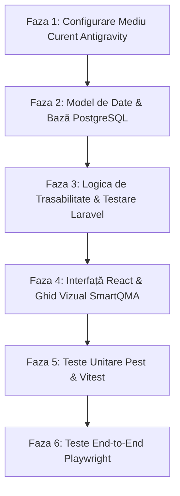

# SmartQMA — Plan de Acțiune & Faze de Implementare

SmartQMA este o aplicație dedicată **trasabilității și analizei calității produselor** dintr-o secție de producție industrială. Sistemul urmărește produsele de-a lungul etapelor de fabricație, înregistrând măsurătorile parametrice și rezultatele testelor la fiecare stație.

---

## 🎯 Puncte Cheie Cuprinse
1. **Mediul Curent de Dezvoltare**:
   - Mediu oficial: **Antigravity**
   - Backend: **PHP 8.2+ / Laravel 11**
   - Frontend: **React + Vite (TypeScript)**
   - Bază de Date: **PostgreSQL 16**
   - Calitate cod local: **Laravel Pint** (PHP) & **ESLint / Prettier** (React)
2. **Ghidul Vizual (Visual Guidelines)**:
   - Paletă industrială: **Roșu**, **Portocaliu**, **Negru**, **Alb**
   - Componente UI: Badge-uri de stare, carduri de măsurători, font monospațiat pentru seriale
3. **Testare Unitară (Unit Testing)**:
   - Suită backend **Pest PHP / PHPUnit** (modele, state machine, validare toleranțe teste)
   - Suită frontend **Vitest** (componente React)
   - Acoperire minimă impusă: **80%**
4. **Testare End-to-End (E2E Testing)**:
   - Suită **Playwright** pentru fluxurile critice de producție (scanare, testare, trecere stare, carantină)

---

## 🗺️ Fazele Planului de Acțiune



---

### Faza 1: Configurare Mediu Curent (Antigravity & Tooling)
- [ ] **Configurare Spațiu de Lucru Antigravity**:
  - Integrare `.vscode/settings.json` (format-on-save cu Pint și Prettier).
  - Extensii pentru PHP, Laravel și React.
- [ ] **Setup Proiect**:
  - Backend Laravel 11 configurat cu PostgreSQL (`.env`).
  - Frontend React cu Vite și TypeScript.
- [ ] **Calitate Cod Local**:
  - `Laravel Pint` pentru verificarea și formatarea stilului PHP (`./vendor/bin/pint`).
  - `ESLint` și `Prettier` pentru verificarea codului React (`npm run lint`).
  - Pre-commit hook pentru rularea automată a linter-ului.

---

### Faza 2: Model de Date & Bază PostgreSQL
- [ ] **Migrații Bază de Date**:
  - `products`: ID unic, serial number, tip produs, lot, stare curentă (`PASSED`, `IN_PROGRESS`, `FAILED`, `QUARANTINED`, `SCRAPPED`).
  - `stages` & `stations`: Etapele procesului tehnologic și stațiile de lucru.
  - `quality_tests`: Înregistrare măsurători (tensiune, dimensiuni, aspect), toleranțe admise și rezultat PASS/FAIL.
  - `audits`: Jurnalizare imutabilă a schimbărilor de stare și a rezultatelor testelor.
- [ ] **Modele Eloquent & Relații**:
  - Implementare relații directe între produse, etape, teste și istoricul de audit.
  - Utilizare `SoftDeletes` pentru prevenirea pierderii accidentale a datelor.

---

### Faza 3: Motorul de Trasabilitate & Înregistrare Teste (Backend Laravel)
- [ ] **State Machine pentru Produse**:
  - Reguli de avansare: un produs poate trece la etapa următoare doar dacă testele etapei curente sunt valide (`PASSED`).
  - Rutare automată în `QUARANTINED` dacă valorile măsurate sunt în afara toleranțelor.
- [ ] **Endpoints API**:
  - Endpoint scanare produs la stație.
  - Endpoint trimitere și validare rezultate teste.
  - Endpoint consultare istoric complet și arbore de trasabilitate.
- [ ] **Autentificare Google**:
  - Integrare Google OAuth2 prin Laravel Socialite (fără parole locale).

---

### Faza 4: Interfață React & Ghid Vizual SmartQMA
- [ ] **Implementare Sistem Vizual**:
  - Integrare paletă: **Negru** (fundal, contrast), **Alb** (suprafețe și text), **Roșu** (erori, defecte, `FAILED`), **Portocaliu** (în lucru, atenționări `WARNING`).
  - Tipografie: Font monospațiat (`JetBrains Mono` / `Roboto Mono`) pentru numere de serie, coduri de bare și valori numerice.
  - Conformitate accesibilitate **WCAG 2.1 AA**.
- [ ] **Ecrane Aplicație**:
  - **Ecran Stație Operator**: Câmp de scanare cu auto-focus, afișare parametri de testare, butoane de confirmare/respingere.
  - **Panou Trasabilitate (Genealogie Produs)**: Stepper vizual cu etapele parcurse, valorile măsurate și starea curentă.
  - **Dashboard Calitate**: Indicatori randament (FPY) și distribuție defecte.

---

### Faza 5: Teste Unitare (Acoperire minimă 80%)
- [ ] **Teste Unitare Backend (Pest PHP / PHPUnit)**:
  - Testarea regulilor de tranziție între stări ale produsului.
  - Testarea validării toleranțelor minime/maxime pentru măsurători.
  - Testarea salvării automate a istoricului de audit.
  - Rulare și verificare acoperire:
    ```bash
    php artisan test --coverage --min=80
    ```
- [ ] **Teste Unitare Frontend (Vitest)**:
  - Testarea componentelor de afișare badge-uri de stare și valori numerice.
  - Testarea validării formularelor de introducere parametri.
  - Rulare:
    ```bash
    npm test
    npm run test:coverage
    ```

---

### Faza 6: Teste End-to-End (Playwright)
- [ ] **Configurare Playwright**:
  - Configurare `playwright.config.ts` pentru rulare pe Chrome/Firefox headless și interactiv.
- [ ] **Scenarii E2E Esențiale**:
  - **Scenariu Conform**: Autentificare -> Scanare produs nou -> Introducere parametri în toleranță -> Validare trecere în starea `PASSED`.
  - **Scenariu Defect**: Scanare produs -> Introducere valoare peste toleranță -> Verificare blocare automată în `QUARANTINED`.
  - **Scenariu Istoric & Audit**: Consultare arbore de trasabilitate și verificare afișare corectă a valorilor înregistrate.
- [ ] **Comenzi de Rulare**:
  ```bash
  npx playwright test
  npx playwright test --ui
  ```
