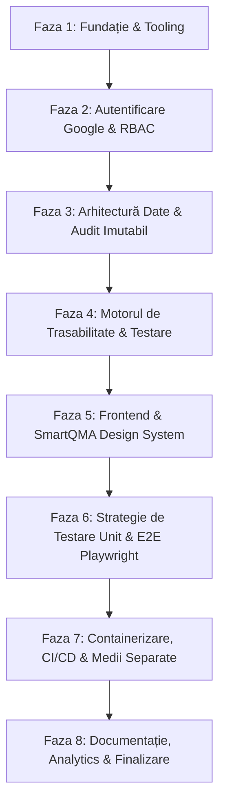

# SmartQMA — Plan de Acțiune & Faze de Implementare

SmartQMA este o platformă modernă dedicată **trasabilității și analizei avansate a produselor** într-o secție de producție industrială. Sistemul monitorizează ciclul complet de viață al fiecărui produs, lot și componentă prin diverse **stagii și stări de fabricație**, înregistrând parametrii de testare calitativă și cantitativă de-a lungul liniilor de producție.

---

## 🎯 Obiective Principale
1. **Trasabilitate Completă**: Urmărirea serialelor/loturilor în timp real prin fiecare stație și punct de control.
2. **Controlul Calității (QA & Testing)**: Înregistrarea parametrilor de testare la fiecare etapă și blocarea automată a produselor neconforme (quarantine/scrap).
3. **Analiză & Raportare**: Tablouri de bord analitice cu rate de randament (Yield), defecte Pareto, timpi de ciclu (Cycle Time) și performanța stațiilor.
4. **Audit Imutabil & Securitate**: Jurnalizare automată la nivel de bază de date a fiecărei modificări de stare, acces exclusiv prin Google OAuth2/OIDC.
5. **Standarde de Inginerie Riguroase**: Calitate cod automată, testare >80%, E2E automatizat zilnic, containerizare Podman & Docker, pipeline-uri CI/CD.

---

## 🏗️ Stack Tehnologic Recomandat

| Componentă | Tehnologie Selectată | Justificare |
| :--- | :--- | :--- |
| **Backend** | **PHP 8.2+ / Laravel 11** | Arhitectură robustă enterprise, Eloquent ORM cu suport nativ pentru JSONB, Laravel Socialite pentru Google Auth, Observers/Pachete de Audit (`owen-it/laravel-auditing`), evenimente și WebSockets (Laravel Reverb / Echo). |
| **Bază de Date & Audit** | **PostgreSQL 16** | Suport pentru tranzacții ACID, tabele de audit istoric, extensii JSONB pentru date flexibile de testare și măsurători parametrice. |
| **Frontend** | **React + Vite (TypeScript)** | Interfață reactivă, componentizare modulară pentru stațiile de scanare și panourile de trasabilitate. |
| **Mediu de Lucru / IDE** | **Antigravity** | Mediul oficial de dezvoltare asistat de inteligență artificială, configurat cu context dedicat pentru întreg proiectul. |
| **Design System** | **SmartQMA Design Tokens** | Paletă industrială personalizată: Roșu, Portocaliu, Negru, Alb. Conformitate WCAG 2.1 AA. |
| **Testare Unitară & Feature** | **Pest PHP / PHPUnit & Vitest** | Teste rapide backend și frontend, prag minim impus de 80% acoperire a codului. |
| **Testare E2E** | **Playwright** | Automatizare completă a fluxurilor utilizator în browser, rulare automată zilnică în CI/CD. |
| **Containerizare** | **Podman & Docker (Compose)** | Compatibilitate duală cu mediu containerizat pentru Laravel, PostgreSQL și React. |
| **CI/CD** | **GitHub Actions** | Automatizare completă: linting, analize de securitate, testare unitară, rulare E2E și deploy. |
| **Autentificare** | **Google OAuth2 / OIDC (Socialite)** | Exclusiv Google Auth; fără parole locale stocate în aplicație. |

---

## 🗺️ Fazele Planului de Acțiune

---

### Faza 1: Fundație, Tooling & Standarde de Cod
- [ ] **Structura Repositoriului**: Organizare monorepo sau structură clară `/client`, `/server`, `/shared`, `/docs`.
- [ ] **Configurare Linter & Formatter**:
  - Backend (Laravel): **Laravel Pint** și **PHPStan** (nivel strict de analiză statică).
  - Frontend (React): **ESLint** (reguli stricte TypeScript) și **Prettier**.
- [ ] **Pre-commit Hooks**:
  - Integrare Git Hooks / Husky + `lint-staged` pentru validare automată linter și teste înainte de orice commit.
- [ ] **Configurare Mediu Antigravity**:
  - Setări de spațiu de lucru pentru Antigravity (`.vscode/settings.json`, extensii esențiale pentru PHP, Laravel și React).
- [ ] **Ghiduri de Contribuție & Protecție**:
  - `.github/pull_request_template.md` și șabloane de Issues (Bug, Feature, Task).
  - Reguli de Branch Protection pe `main` (fără direct commits, minim 1 review, status checks verzi).
  - Instrucțiuni AI: `.github/copilot-instructions.md` și `AGENTS.md`.

---

### Faza 2: Autentificare Google & Control Acces (RBAC)
- [ ] **Configurare Google OAuth2 / OpenID Connect**:
  - Implementare flux de login exclusiv cu contul Google (fără tabele de parole locale).
  - Validare ID Token Google pe backend și generare sesiune securizată (JWT HTTP-only cookie).
- [ ] **Matricea de Roluri și Permisiuni (RBAC)**:
  - `OPERATOR`: Poate scana produse, bifa începerea/finalizarea etapelor, înregistra măsurători manuale de test.
  - `QUALITY_INSPECTOR` (QA): Poate valida teste de calitate, aproba/respinge loturi, plasa produse în carantină.
  - `LINE_MANAGER`: Configurează liniile de producție, etapele și parametrii de testare, vizualizează rapoarte analitice.
  - `ADMIN`: Administrează utilizatorii, integrările și politicile de securitate.
- [ ] **Middleware & Guards**: Verificarea autorizării la nivel de endpoint API și pe rutele din interfață.

---

### Faza 3: Arhitectură Date, Model de Trasabilitate & Audit Imutabil
- [ ] **Schema Bazei de Date (PostgreSQL)**:
  - `products`: ID unic, serial number (UUID/Barcode/QR), tip produs, lot (batch_id), stare curentă, creat_la.
  - `production_lines` & `stations`: Linii de fabricație, stații fizice, capacitate.
  - `stages`: Etape de fabricație ordonate secvențial sau cu dependențe grafo-orientate (ex: Asamblare -> Test Preliminar -> Finisare -> Test Final -> Ambalare).
  - `stage_executions`: Trecerea fiecărui produs printr-o etapă (operator_id, timestamp_start, timestamp_end, status: IN_PROGRESS / PASSED / FAILED / REWORKED).
  - `quality_tests`: Parametri de test (tensiune, dimensiune, etanșeitate, aspect vizual), valori măsurate, toleranțe min/max, rezultat PASS/FAIL.
  - `defects`: Înregistrare anomalii, cauze rădăcină (root-cause), acțiuni corective (scrap/rework).
- [ ] **Audit Trail Automat**:
  - Implementare mecanism de audit imutabil (folosind `owen-it/laravel-auditing` sau Eloquent Observers pe modelele `Product`, `QualityTest`, `StageExecution`):
    - Înregistrare automată: `user_id`, `event` (`created`, `updated`, `deleted`), `old_values`, `new_values`, `ip_address`, `user_agent`, `created_at`.
    - Nicio ștergere dură (SoftDeletes în Laravel).
- [ ] **Sistem Automat de Backup**:
  - Backup automat programat (folosind `spatie/laravel-backup` sau scripturi `pg_dump` pe PostgreSQL) cu reținere istorică și proceduri documentate de restaurare.

---

### Faza 4: Motorul de Trasabilitate & Înregistrare Teste (Backend Core)
- [ ] **State Machine pentru Produse**:
  - Validarea strictă a tranzițiilor de stare: un produs nu poate trece la etapa $N+1$ dacă etapa $N$ nu a fost finalizată cu `PASSED`.
  - Tratarea excepțiilor: Carantină (`QUARANTINED`), Re-lucrare (`REWORK`), Casare (`SCRAPPED`).
- [ ] **API de Testare & Măsurători**:
  - Endpoint-uri de ingestie a rezultatelor testelor automate (ex: payload JSON de la bancuri de testare).
  - Validare automată pe baza specificațiilor tehnice (toleranțe).
- [ ] **WebSockets / Server-Sent Events (SSE)**:
  - Notificări în timp real pe liniile de producție atunci când o stație raportează un defect critic sau o oprire a liniei.

---

### Faza 5: Frontend & SmartQMA Design System
- [ ] **Implementare Design System SmartQMA**:
  - Paletă cromatică industrială conform cerințelor: **Roșu** (erori, alerte calitate), **Portocaliu** (avertizări, în curs), **Negru** (fundal modern, structură dark/industrială), **Alb** (suprafețe curate, contrast maxim).
  - Componente de status: Badges interactive pentru stări (`PASSED`, `TESTING`, `FAILED`, `QUARANTINE`).
  - Respectare WCAG 2.1 AA (contrast ridicat, lizibilitate crescută pe ecrane de uzină/tablete).
- [ ] **Ecrane Principale**:
  - **Operator Station View**: Ecran simplificat, optimizat pentru tastatură/scanner cod de bare, acțiuni rapide de trecere etapă și introducere valori test.
  - **Product Genealogy / Traceability Tree**: Vizualizare completă a istoricului unui produs (cine l-a asamblat, pe ce linie, la ce dată, ce teste a trecut).
  - **Quality Analytics & Dashboard**: Rate de conformitate (First Pass Yield - FPY), grafice Pareto pentru defecte frecvente, distribuții gaussiene ale măsurătorilor de test.
  - **Audit Log Viewer**: Ecran dedicat pentru auditori și manageri pentru investigarea oricărei schimbări de stare.

---

### Faza 6: Strategie de Testare (Unit & E2E cu Playwright)
- [ ] **Unit & Feature Testing (Acoperire minimă 80%)**:
  - Testarea regulilor de business ale state machine-ului în Laravel (Pest / PHPUnit).
  - Testarea validării parametrilor de testare și calculul toleranțelor.
  - Testarea mecanismului de audit pe modelele Eloquent.
  - Testarea componentelor React (Vitest / React Testing Library).
  - Măsurare automată a acoperirii (`php artisan test --coverage` și `npm run test:coverage`) blocantă la build.
- [ ] **End-to-End Testing (Playwright)**:
  - Scenariu 1: Autentificare utilizator -> Creare produs / lot -> Trecere prin stații de producție.
  - Scenariu 2: Introducere valori de test invalide -> Blocare automată produs în starea `FAILED`/`QUARANTINED`.
  - Scenariu 3: Consultare arbore de trasabilitate și verificare generare înregistrări în log-ul de audit.
- [ ] **Rulare Automată E2E**:
  - Workflow GitHub Actions programat zilnic (ex: la ora 02:00 UTC) și la fiecare Pull Request către `main`.

---

### Faza 7: Containerizare, CI/CD & Separare Medii
- [ ] **Dual Containerization (Podman & Docker)**:
  - `Dockerfile` multi-stage optimizat pentru producție (reducere dimensiune imagine, securitate non-root user).
  - `compose.yaml` (și `docker-compose.yml`) pentru pornirea rapidă a întregului stack (App, PostgreSQL, Redis).
  - Testare și validare a compatibilității identice atât cu comenzi `docker`, cât și cu `podman`.
- [ ] **Separare Medii**:
  - Mediu **Staging / Development**: Bază de date de test cu date sintetice de uzină, logging detaliat.
  - Mediu **Production**: Bază de date securizată cu backup activ, audit strict, optimizări de performanță.
  - Fără secrete în cod: fișiere `.env.example` și gestionare prin GitHub Repository Secrets.
- [ ] **Pipeline CI/CD GitHub Actions**:
  - Job de Linting & Typecheck.
  - Job de Testare Unitară cu raport de acoperire.
  - Job de Testare E2E.
  - Job de Build Container & Verificare Vulnerabilități (Dependabot / Snyk / CodeQL).
  - Triggere automate de deploy pentru `develop` (staging) și `main` (production).

---

### Faza 8: Documentație, Manuale & Pregătire Licență
- [ ] **Documentație Arhitecturală**: Diagrame C4, model ERD bază de date, fluxuri de stare ale produsului.
- [ ] **Configurare Mediu Antigravity**: Ghid de lucru și bune practici în Antigravity cu AI Agent.
- [ ] **API Docs**: Documentație interactivă Swagger / OpenAPI / Scramble pentru toate endpoint-urile Laravel.
- [ ] **Raport & Sinteză Lucrare de Licență**: Concluzii asupra eficienței reducerii timpului de localizare a defectelor și îmbunătățirea trasabilității în producție.
