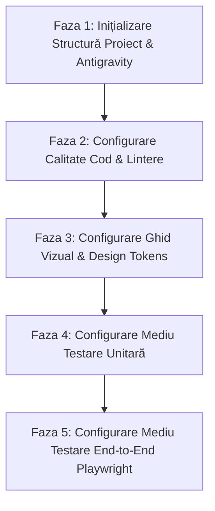

# SmartQMA — Plan de Configurare Stack Tehnic & Mediu de Lucru

Acest plan de acțiune detaliază configurarea completă a **stack-ului tehnic** și a **mediului de dezvoltare** pentru proiectul SmartQMA, fără a include logica de business sau paginile aplicației.

---

## 🎯 Obiectivul Configurării
Implementarea unei infrastructuri de dezvoltare robuste, curate și complet verificate, compusă din:
1. **Mediul de lucru local**: **Antigravity**
2. **Backend**: **PHP 8.2+ / Laravel 11**
3. **Frontend**: **React + Vite (TypeScript)**
4. **Bază de Date**: **PostgreSQL 16**
5. **Ghidul Vizual (Design Tokens)**: Paleta industrială **Roșu, Portocaliu, Negru, Alb**
6. **Suita de Testare Unitară**: **Pest PHP / PHPUnit** (Backend) & **Vitest** (Frontend) cu prag minim de **80% coverage**
7. **Suita de Testare End-to-End**: **Playwright**

---

## 🗺️ Fazele Planului de Configurare a Stack-ului



---

### Faza 1: Inițializare Structură Proiect & Configurare Mediu Antigravity
- [ ] **Configurare Spațiu de Lucru Antigravity**:
  - Validare `.vscode/settings.json` (format-on-save, reguli linter, setări editor).
  - Validare `.vscode/extensions.json` (Laravel Pint, PHP Intelephense, ESLint, Prettier, Playwright).
- [ ] **Inițializare Proiect Backend (Laravel 11)**:
  - Creare / inițializare schelet aplicație Laravel 11 (PHP 8.2+).
  - Configurare fișier `.env` pentru conexiunea la instanța locală de **PostgreSQL 16**.
  - Verificare funcționare conexiune bază de date (`php artisan migrate:status`).
- [ ] **Inițializare Proiect Frontend (React + Vite)**:
  - Inițializare schelet aplicație React cu TypeScript și Vite.
  - Configurare integrare între frontend și backend (Vite proxy / rute API).
- [ ] **Controlul Versiunilor & Ignorare Fișiere**:
  - Validare fișier `.gitignore` pentru dependințe PHP (`/vendor`), Node (`node_modules`), fișiere build (`dist/`, `public/build`) și fișiere `.env`.

---

### Faza 2: Configurare Calitate Cod & Lintere (Linting & Code Quality)
- [ ] **Configurare Backend (PHP / Laravel)**:
  - Integrare **Laravel Pint** pentru formatare automată și respectarea standardelor PSR-12:
    ```bash
    ./vendor/bin/pint --test
    ./vendor/bin/pint
    ```
  - Integrare **PHPStan** pentru analiză statică strictă de tipuri:
    ```bash
    ./vendor/bin/phpstan analyse
    ```
- [ ] **Configurare Frontend (React / TypeScript)**:
  - Configurare **ESLint** cu reguli stricte pentru TypeScript.
  - Configurare **Prettier** pentru formatarea automată a fișierelor `.tsx`, `.ts`, `.css`.
  - Scripturi în `package.json`:
    ```bash
    npm run lint
    npm run lint:fix
    npm run format:check
    ```
- [ ] **Pre-commit Hooks**:
  - Configurare Git Hooks (Husky / `lint-staged`) pentru a rula Pint și ESLint înainte de fiecare commit.

---

### Faza 3: Configurare Ghid Vizual & Design Tokens
- [ ] **Definire Token-uri CSS & Variabile Globale**:
  - Creare fișier de bază pentru variabile de stil (ex: `tokens.css` sau configurare Tailwind/CSS Modules).
  - Paleta de culori obligatorie:
    - **Negru**: `--color-black: #09090B`, `--color-surface-dark: #18181B`
    - **Alb**: `--color-white: #FFFFFF`, `--color-surface-light: #FAFAFA`
    - **Roșu**: `--color-red-primary: #DC2626`, `--color-red-dark: #991B1B`
    - **Portocaliu**: `--color-orange-primary: #EA580C`, `--color-orange-amber: #F97316`
- [ ] **Configurare Tipografie**:
  - Font primar UI (sans-serif): `Inter` / `Roboto`.
  - Font monospațiat pentru date/valori/seriale: `JetBrains Mono` / `Roboto Mono`.
- [ ] **Stiluri de Bază pentru Componente Primare**:
  - Token-uri pentru butoane, input-uri, carduri și badge-uri de stare.
  - Verificare conformitate contrast minim **WCAG 2.1 AA**.

---

### Faza 4: Configurare Mediu de Testare Unitară (Acoperire minimă 80%)
- [ ] **Configurare Suită Backend (Pest PHP / PHPUnit)**:
  - Instalare și configurare **Pest PHP** sau **PHPUnit**.
  - Configurare raportare automată a acoperirii codului (coverage driver: Xdebug sau PCOV).
  - Test de validare inițial (smoke test) pentru verificarea rulării suitei:
    ```bash
    php artisan test --coverage --min=80
    ```
- [ ] **Configurare Suită Frontend (Vitest)**:
  - Instalare și configurare **Vitest** + **React Testing Library** + **jsdom**.
  - Configurare raport de acoperire cod frontend (`c8` / `@vitest/coverage-v8`).
  - Test de validare inițial (smoke test de componentă):
    ```bash
    npm test
    npm run test:coverage
    ```

---

### Faza 5: Configurare Mediu de Testare End-to-End (Playwright)
- [ ] **Instalare & Configurare Playwright**:
  - Instalare pachet `@playwright/test` și descărcare binare browsere (`npx playwright install --with-deps`).
  - Creare fișier `playwright.config.ts`:
    - Definire `baseURL` local.
    - Configurare pornire automată a serverului de test (webServer).
    - Rulare pe browsere desktop (Chromium, Firefox, WebKit).
- [ ] **Smoke Test Inițial E2E**:
  - Creare test minimal de sănătate a stivei (verificare încărcare pagină rădăcină și răspuns HTTP 200).
  - Verificare comenzi de rulare:
    ```bash
    # Rulare teste headless
    npx playwright test

    # Rulare interactiva cu UI
    npx playwright test --ui
    ```
