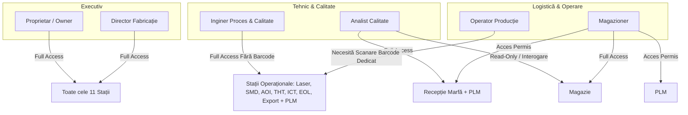
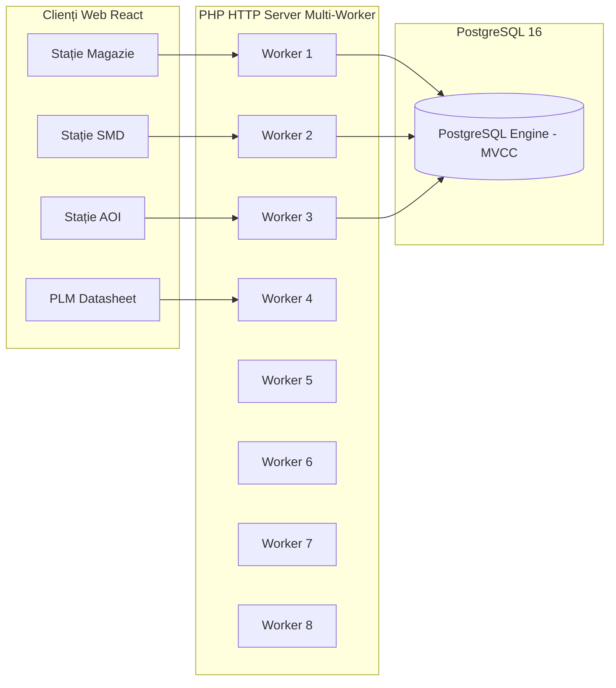

# SmartQMA — Arhitectură Industrială, Posturi de Lucru & Sistem de Securitate

Acest document reprezintă referința tehnică completă pentru arhitectura platformei **SmartQMA**: fluxul de producție, cele 11 stații de lucru, matricea de roluri și securitate pe bază de cod de bare, managementul ciclului de viață al componentelor (PLM), gestiunea magaziei și sistemul de performanță multi-worker cu lățime de bandă adaptivă.

---

## 📑 Cuprins
1. [Arhitectura Celor 11 Posturi de Lucru](#1-arhitectura-celor-11-posturi-de-lucru)
2. [Matricea de Roluri și Permisiuni Industriale](#2-matricea-de-roluri-și-permisiuni-industriale)
3. [Securitatea pe Bază de Cod de Bare pentru Operatori](#3-securitatea-pe-bază-de-cod-de-bare-pentru-operatori)
4. [Product Lifetime Management (PLM) & Fișe Tehnice](#4-product-lifetime-management-plm--fișe-tehnice)
5. [Zona de Stocare — Magazie](#5-zona-de-stocare--magazie)
6. [Arhitectura de Performanță & Sistem Multi-Worker](#6-arhitectura-de-performanță--sistem-multi-worker)
7. [Gestiunea Inteligentă a Lățimii de Bandă (DownloadBandwidthManager)](#7-gestiunea-inteligentă-a-lățimii-de-bandă-downloadbandwidthmanager)
8. [Catalog API RESTful](#8-catalog-api-restful)

---

## 1. Arhitectura Celor 11 Posturi de Lucru

Fiecare post de lucru are un cod unic de identificare standardizat (`WS-XXX-YY`), o categorie industrială, un tip funcțional și o listă strictă de roluri autorizate.

| # | Slug Stație | Cod Stație | Titlu Oficial Stație | Categorie | Roluri Autorizate | Descriere Operațională |
|---|---|---|---|---|---|---|
| 1 | `magazie` | `WS-MAG-01` | Zona de stocare - Magazie | Stocare & Logistică | Magazioner, Analist Calitate (limitat), Inginer, Director, Proprietar | Recepție, stocare, evidență comenzi componente electronice, trasabilitate loturi furnizor și FIFO. |
| 2 | `receptie-marfa` | `WS-REC-02` | Punct de verificare - Receptie marfa | Control Calitate Intrare | Analist Calitate, Magazioner, Inginer, Director, Proprietar | Inspectare vizuală pachete, verificare certificate CoC și conformitate specificații la intrarea în fabrică. |
| 3 | `qr-laser` | `WS-LSR-03` | Zona de marcare - QR Laser | Identificare & Marcare | Operator*, Inginer, Director, Proprietar | Gravare laser cod DataMatrix 2D / QR pe fiecare PCB pentru trasabilitate unică la nivel de serie. |
| 4 | `smd` | `WS-SMD-04` | Zona de amplasare - SMD | Asamblare Suprafață | Operator*, Inginer, Director, Proprietar | Linii automate pick-and-place, serigrafie pastă de lipit, montare componente pe suprafață și cuptor reflow. |
| 5 | `aoi` | `WS-AOI-05` | Punct de verificare - AOI | Inspecție Optică Automată | Operator*, Inginer, Director, Proprietar | Scanare optică de înaltă rezoluție a plăcilor PCB: detecție punți de cositor, piese lipsă sau decalate. |
| 6 | `tht` | `WS-THT-06` | Zona de amplasare - THT | Asamblare Manuală / THT | Operator*, Inginer, Director, Proprietar | Inserție manuală/robotizată componente voluminoase Through-Hole (conectori, condensatori mari) și lipire selectivă. |
| 7 | `ict` | `WS-ICT-07` | Punct de verificare - ICT | Testare Electrică În Circuit | Operator*, Inginer, Director, Proprietar | Testare electrică automată prin pat de ace (In-Circuit Test): măsurare rezistențe, capacități, continuitate trasee. |
| 8 | `eol` | `WS-EOL-08` | Punct de verificare - EOL | Testare Funcțională Finală | Operator*, Inginer, Director, Proprietar | Testare finală End-of-Line: alimentare la tensiune nominală, calibrare senzori, scriere firmware și validare funcțională. |
| 9 | `export` | `WS-EXP-09` | Zona de scanare - Export | Scanare & Ambalare Finală | Operator*, Inginer, Director, Proprietar | Verificare finală, ambalare ESD, asociere cutie/palet, generare etichete de expediție și închidere lot. |
| 10 | `statistica` | `WS-STA-10` | Statistica | Management & Analiză | Director, Proprietar | Tablou executiv: indicatori FPY (First Pass Yield), Scrap Rate, timpi de tact și distribuția defectelor pe linii. |
| 11 | `plm` | `WS-PLM-11` | Product Lifetime Management (PLM) | Management Date Tehnice | Inginer, Magazioner, Analist Calitate, Director, Proprietar | Nomenclator componente, specificații tehnice, consultare fișe de catalog (datasheets) și ciclu de viață piese. |

*\*Rolul de operator necesită validarea legitimației prin scanarea codului de bare specific pe stație.*

---

## 2. Matricea de Roluri și Permisiuni Industriale

Toate rolurile sunt definite conform normelor limbii române:

### Specificații pe rol:
1. **Proprietar (`owner`)** & **Director Fabricație (`director`)**:
   - Acces complet și nerestricționat la toate cele 11 posturi și la tabloul de bord statistic.
2. **Inginer Proces & Calitate (`engineer`)**:
   - Acces direct, fără necesitatea scanării legitimației pe toate posturile de producție (`qr-laser`, `smd`, `aoi`, `tht`, `ict`, `eol`, `export`), plus acces în `plm`.
3. **Magazioner (`magazioner`)**:
   - **Magazie**: acces complet (înregistrare comenzi noi, adăugare identuri noi în nomenclator, editare livrare/recepție, confirmare sosire, ștergere comenzi).
   - **Recepție marfă**: acces permis.
   - **PLM**: acces complet.
4. **Analist Calitate (`analist_calitate`)**:
   - **Recepție marfă**: acces complet la validarea calitativă a loturilor intrate.
   - **Magazie**: **acces limitat (read-only)** — poate doar interoga comenzi și identuri; butoanele de adăugare comandă/ident și acțiunile de editare/ștergere din meniul contextual sunt ascunse.
   - **PLM**: acces complet.
5. **Operator Producție (`operator`)**:
   - Are acces **exclusiv** pe posturile operaționale de pe linie (`qr-laser`, `smd`, `aoi`, `tht`, `ict`, `eol`, `export`).
   - Accesul pe fiecare post este blocat până la scanarea/introducerea codului de bare personal alocat stației respective.
   - Nu are acces în Magazie, Recepție marfă, PLM sau Statistică (sistemul afișează automat ecranul `RestrictedAccess`).

---

## 3. Securitatea pe Bază de Cod de Bare pentru Operatori

Pentru a preveni ca un operator alocat pe linia SMD să opereze greșit pe stația AOI sau laser, sistemul utilizează o barieră de securitate la nivel de interfață și bază de date.

### Baza de date: Tabela `user_station_access`
Fiecare drept de acces este salvat explicit în tabela `user_station_access`:
- `user_id` (FK către `users`)
- `barcode` (string, legitimație operator)
- `station_id` (slug-ul postului: `smd`, `aoi` etc.)
- `is_authorized` (boolean)

### Legitimații predefinite pentru testare:
- `operator_smd` (`BC-OP-SMD-001`) ➔ autorizat pentru postul `smd`.
- `operator_aoi` (`BC-OP-AOI-002`) ➔ autorizat pentru postul `aoi`.
- `operator` (`BC-OP-GEN-003`) ➔ autorizat pentru toate posturile de producție.

### Comportament în interfață:
Când un operator navighează pe un post operațional, ecranul este acoperit de modalul `OperatorBarcodeModal`:
- Câmp cu autofocalizare compatibil cu cititoarele hardware USB de coduri de bare.
- Validare asincronă prin `POST /api/v1/auth/verify-station-barcode`.
- Deblocare instantanee la scanarea unui cod valid.
- Buton de anulare care deconectează în siguranță operatorul în loc să permită devierea către alte posturi.

---

## 4. Product Lifetime Management (PLM) & Fișe Tehnice

Pagina **Product lifetime management (PLM)** asigură guvernanța nomenclatorului de piese electronice utilizate pe linia de fabricație.

### Structură tabelară:
- Coloane afișate: `#`, `Ident`, `Denumire componentă`, `Cod producător (MPN)`, `Furnizor`, `Tip capsulă`, `Producător`, `Unitate`, `Fișă tehnică`.
- **Filtrare avansată**: Rând de celule de interogare dedicat sub fiecare coloană. Căutarea se declanșează strict la tasta **Enter**.
- **Protecție bază de date**: Căutările oarbe de tip `%%` sau `%` sunt blocate cu notificare informativă pentru prevenirea încărcării inutile a serverului.
- **Paginare dinamică (Infinite Scroll)**: Butonul **Toate (%%)** încarcă primele 50 de elemente, iar la derularea tabelului în jos se încarcă incremental tranșe noi de câte 50 de componente.
- **Export CSV**: Descarcă nomenclatorul filtrat cu caractere speciale și diacritice codate UTF-8 BOM.

### Dosar unic centralizat de fișe tehnice: `ident-storage/`
- Toate fișierele PDF sunt menținute exclusiv în directorul `ident-storage/` din rădăcina proiectului (montat ca volum Docker în `/var/www/html/ident-storage`).
- **Fără duplicate**: S-au eliminat complet copiile multiple redundante din directoarele publice.
- **Vizualizator PDF in-modal adaptiv**:
  - Modal optimizat pentru citire tehnică (`width: 92vw; max-width: 1240px; height: 88vh;`).
  - `<iframe>` randat cu `position: absolute; width: 100%; height: 100%;` pentru a preveni colapsarea înălțimii la 150px.
  - Parametru `#view=FitH` pentru încadrarea automată pe lățime a paginilor PDF.
  - Butoane rapide: *Deschide în filă nouă*, *Descarcă PDF*, *Închide* (suport tasta Escape).

---

## 5. Zona de Stocare — Magazie

Modulul de Magazie gestionează comenzile de piese electronice, numerele de urmărire AWB și recepția în depozit.

- **Filtrare & Căutare**: Rând de interogare pe coloane activat la tasta Enter, cu suport pentru căutări prefix, infix și sufix.
- **Meniu contextual la click dreapta**:
  - Editare livrare / recepție (AWB tracking number, status recepție fizică, data sosirii).
  - Confirmare rapidă sosire în depozit.
  - Copiere număr de urmărire AWB în clipboard.
  - Anulare / ștergere comandă.
- **Restricție de securitate**: Pentru `analist_calitate`, opțiunile de modificare și adăugare sunt eliminate, meniul contextual oferind doar copierea numărului de urmărire.

---

## 6. Arhitectura de Performanță & Sistem Multi-Worker

Pentru a susține utilizarea simultană pe mai multe calculatoare și stații de pe linia de fabricație fără lag sau blocaje:

### Configurație Docker Backend:
- Serverul PHP este compilat cu extensia **`pcntl`** activată.
- În `backend/Dockerfile` și `compose.yaml`:
  `PHP_CLI_SERVER_WORKERS=8` și comanda de pornire `php artisan serve --host=0.0.0.0 --port=8000 --no-reload`.
- **9 procese PHP paralele** rulează simultan în container: cererile HTTP concurente sunt servite instantaneu în paralel pe nuclee diferite de procesor.
- Baza de date PostgreSQL funcționează în mod multi-proces cu izolare MVCC, permițând scrieri de teste industriale în timp ce alte stații interoghează stocurile.

---

## 7. Gestiunea Inteligentă a Lățimii de Bandă (DownloadBandwidthManager)

Pentru a asigura că descărcarea unor documente PDF voluminoase (ex: cataloage de componente de 10 MB) nu saturează rețeaua și nu provoacă lag operatorilor de pe linie:

Clasa de serviciu [`DownloadBandwidthManager`](file:///f:/Licenta/SmartQMA/backend/app/Services/DownloadBandwidthManager.php) implementează un algoritm adaptiv:

1. **Bazin total alocat descărcărilor mari**: `8 MB/s` (8,388,608 bytes/sec).
2. **Viteză maximă per utilizator**: `6 MB/s` (dacă un singur utilizator descarcă, fișierul vine aproape instant).
3. **Împărțirea dinamică a benzii**: Dacă 2 sau mai mulți utilizatori descarcă simultan, viteza se calculează:
   $$\text{Viteză alocată} = \max\left(1 \text{ MB/s}, \min\left(6 \text{ MB/s}, \frac{8 \text{ MB/s}}{N_{\text{conexiuni}}}\right)\right)$$
4. **Reevaluare periodică la fiecare 2 secunde**:
   - Bucla de streaming trimite un *heartbeat* atomic într-un fișier de registru blocat cu `flock`.
   - La fiecare 2 secunde se numără conexiunile active și se redistribuie debitul în mers.
   - Dacă o descărcare se finalizează sau utilizatorul închide tab-ul, celelalte conexiuni accelerează automat în maxim 2 secunde.
5. **Garantare zero lag**: Restul lățimii de bandă și al proceselor worker rămân 100% disponibile pentru API-ul principal (scanări QR, comenzi, teste).

---

## 8. Catalog API RESTful

### Autentificare & Securitate Posturi
- `POST /api/v1/auth/login`: Autentificare cu utilizator și parolă; returnează token și date utilizator.
- `POST /api/v1/auth/verify-station-barcode`: Verificare autorizație legitimație operator pentru stația specificată.
- `GET /api/v1/workstations`: Returnează lista celor 11 posturi industriale, rolurile permise și descrierile.

### Product Lifetime Management (PLM) & Nomenclator
- `GET /api/v1/idents`: Interogare paginată și căutare wildcard în nomenclator (`limit`, `offset`, `ident`, `part_name`, `provider` etc.).
- `POST /api/v1/idents`: Înregistrare ident nou (suport încărcare fișier `datasheet` direct în `ident-storage/`).
- `GET /api/v1/idents/{ident}/datasheet`: Streaming controlat la debit adaptiv al fișierului PDF din `ident-storage/{ident}.pdf`.
- `POST /api/v1/idents/{ident}/datasheet`: Încărcare și actualizare fișă tehnică în dosarul centralizat.

### Magazie & Comenzi Stoc
- `GET /api/v1/inventory`: Interogare paginată a comenzilor din depozit cu filtre avansate.
- `POST /api/v1/inventory`: Înregistrare comandă nouă de componente.
- `PATCH /api/v1/inventory/{id}/arrival`: Actualizare status recepție fizică și număr de urmărire AWB.
- `DELETE /api/v1/inventory/{id}`: Ștergere/anulare comandă de componente.

### Producție & Trasabilitate Serializată
- `GET /api/v1/laser/markings`: Listă plăci PCB gravate cu filtru pe serie 12 cifre, model, operator, status.
- `GET /api/v1/laser/next-serial`: Calcul automat serie următoare de 12 cifre (`YYMMDD` + 6 cifre incrementabile zilnic).
- `POST /api/v1/laser/mark`: Gravare laser automată (+1) sau manuală cu validare strictă a formatului de 12 cifre.
- `POST /api/v1/laser/rescan`: Rescanare și verificare conformitate marcaj laser DataMatrix 2D PCB.
- `GET /api/v1/placements/smd`: Listă amplasări componente SMD efectuate pe linia Pick & Place.
- `POST /api/v1/placements/smd`: Înregistrare amplasare componentă SMD pe PCB.
- `GET /api/v1/feeders/{stationId}`: Listă alimentatoare (feeder rack) active pe linia de producție.
- `POST /api/v1/feeders/load`: Înregistrare scanare rolă de componente pe alimentatorul liniei.
- `GET /api/v1/placements/tht`: Listă componente Through-Hole inserate și lipite.
- `POST /api/v1/placements/tht`: Înregistrare inserție componentă THT pe PCB.
- `GET /api/v1/tests/aoi`: Listă inspecții optice automate post-reflow.
- `POST /api/v1/tests/aoi`: Înregistrare rezultat inspecție AOI (`PASS` / `FAIL`).
- `GET /api/v1/tests/ict`: Listă rezultate teste electrice pe pat de ace (Bed of Nails).
- `POST /api/v1/tests/ict`: Înregistrare rezultat testare electrică ICT (`PASS` / `FAIL`).
- `GET /api/v1/tests/eol`: Listă rezultate teste funcționale finale la capăt de linie.
- `POST /api/v1/tests/eol`: Înregistrare rezultat testare funcțională finală EOL (`PASS` / `FAIL`).
- `GET /api/v1/traceability/scan/{qr}`: Istoric complet PCB (amplasări componente Bestück SMD/THT și rezultate teste).

---

## 9. Arhitectura Posturilor de Lucru Industriale

### 1. Zona de marcare — QR Laser (`WS-LSR-03`)
- **Format serie PCB**: Exact **12 cifre numerice**, compuse din data fabricației în format `YYMMDD` (ex: `260902` pentru 2 septembrie 2026 sau `261029` pentru 29 octombrie 2026), urmate de un număr secvențial zilnic de **6 cifre** (`000001` - `999999`). Exemplu complet: `261029000001`.
- **Mecanisme**:
  - Gravare automată (+1): calculează instant următorul număr secvențial al zilei și gravează codul DataMatrix 2D.
  - Introducere manuală: zonă rapidă dedicată și formular modal cu validare strictă prin regex (`^\d{12}$`).
  - Rescanare piesă: scanează codul de pe PCB pentru confirmarea calității gravării și afișează istoricul de trasabilitate.
- **Tabel**: Afișează în timp real ultimele serii marcate, puterea laserului (85%), durata impulsului (420 ms), operatorul și statusul (`OK` / `RESCANAT`).

### 2. Zona de amplasare — SMD (`WS-SMD-04`)
- **Management alimentatoare (Feeder Rack)**: Permite scanarea și asocierea rolelor din magazie (identuri >10000) pe sloturile active ale mașinii Pick & Place (ex: `U3`, `U5`, `U2`, `U4`, `T1`, `F1`, `Y1`).
- **Tabel amplasări**: Monitorizează piesele montate pe fiecare serie de PCB, afișând denumirea componentei, lotul furnizorului, slotul și operatorul.

### 3. Punct de verificare — AOI (`WS-AOI-05`)
- **Inspecție optică automată**: Verifică conformitatea joncțiunilor de lipire post-reflow.
- **Indicatori de performanță (FPY)**: Calculează automat rata *First Pass Yield* (FPY %), numărul de plăci acceptate (`PASS`) și respinse (`FAIL`).
- **Coduri industriale de defect**: `BRIDGE_U3` (punte cositor), `MISSING_R1` (componentă lipsă), `TOMBSTONE_C2` (componentă ridicată), `OFFSET_U2` (deplasare axă X/Y), `POLARITY_D1` (polaritate inversată), `INSUFFICIENT_SOLDER`.

### 4. Zona de amplasare — THT (`WS-THT-06`)
- **Inserție Through-Hole & Lipire selectivă**: Gestionarea montajului componentelor voluminoase (ex: microcontroler DIP-28 `U1`, conectori `J1`/`J2`, jack DC).
- **Control parametri proces**: Monitorizare temperatură cuvă cositor (`260°C`), aliaj ecologic fără plumb `SAC305`, fluxant no-clean și înălțime val.

### 5. Punct de verificare — ICT (`WS-ICT-07`)
- **Testare pe pat de ace (Bed of Nails Fixture)**: Măsurare parametri pasivi și tensiuni de alimentare pe trasee electrice.
- **Măsurători verificate**: Tensiune regulator 5V (`U5_VOUT: 5.01V`), 3.3V (`U2_VOUT: 3.30V`), frecvență rezonator (`Y1_FREQ: 16.000MHz`), izolație alimentare VCC-GND (`>100kΩ`).
- **Semnalare net-uri eșuate**: Izolare scurtcircuite (ex: `NET_3V3_SHORT`).

### 6. Punct de verificare — EOL (`WS-EOL-08`)
- **Testare funcțională finală**: Validare completă a produsului gata asamblat la parametri nominali.
- **Verificări automate**: Consum de curent în funcționare (normal: `47.85 mA`), enumerare USB cu verificare VID/PID, integritate flash bootloader CRC, buclă UART TX/RX Loopback la 115200 baud și comutare pini I/O (D0-D13, A0-A5).
- **Certificare lot**: Asigură acordarea verdictului final `PASS` înainte de ambalare și expediere.

