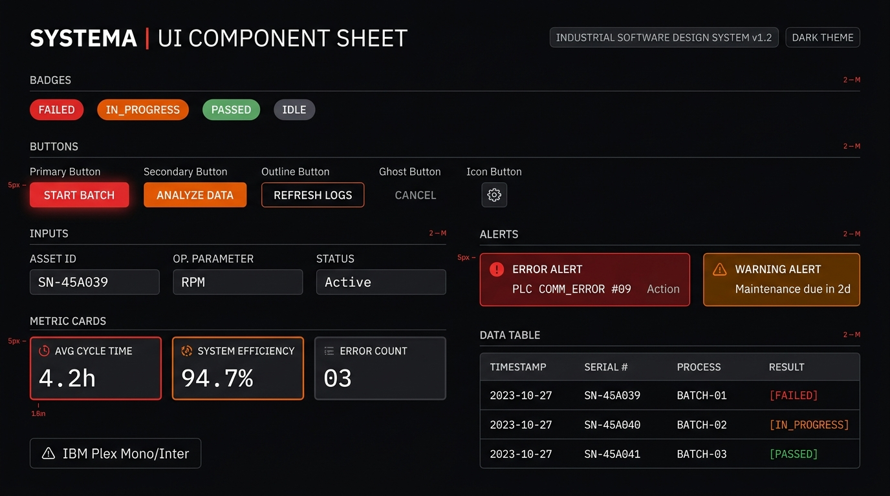
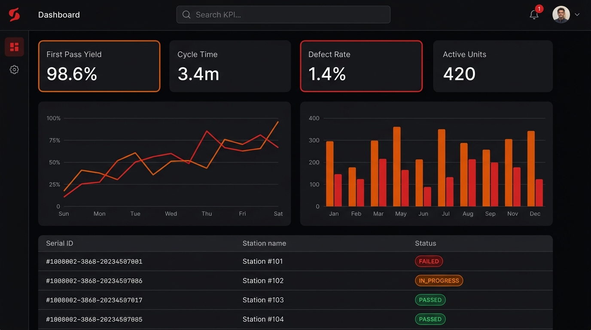
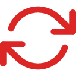

# SmartQMA — Sistem Vizual Complet & Design System

Sistemul vizual **SmartQMA** este un ghid complet de componente, token-uri de stil, iconițe și reguli de interfață optimizate pentru mediul industrial. Acesta asigură contrast ridicat, lizibilitate instantanee conform standardului **WCAG 2.1 AA** și o estetică modernă bazată pe tema **Dark/Light Industrial**.

---

## 🖼️ Previzualizare Vizuală & Mockup-uri





---

## 📑 Cuprins
1. [Paleta Cromatică & Token-uri CSS](#1-paleta-cromatică--token-uri-css)
2. [Sistemul Tipografic & Spațiere](#2-sistemul-tipografic--spațiere)
3. [Colecția de Iconițe Generice (SVG)](#3-colecția-de-iconițe-generice-svg)
4. [Sistemul de Butoane (Componente & Exemple)](#4-sistemul-de-butoane-componente--exemple)
5. [Câmpuri de Intrare & Formulare](#5-câmpuri-de-intrare--formulare)
6. [Badge-uri & Indicatori de Stare](#6-badge-uri--indicatori-de-stare)
7. [Carduri Metrice & Panouri Structurale](#7-carduri-metrice--panouri-structurale)
8. [Alerte & Notificări Banner](#8-alerte--notificări-banner)
9. [Tabele de Date Industriale](#9-tabele-de-date-industriale)
10. [Reguli de Accesibilitate (WCAG 2.1 AA)](#10-reguli-de-accesibilitate-wcag-21-aa)

---

## 1. Paleta Cromatică & Token-uri CSS

Paleta este construită strict pe cele 4 culori cerute: **Negru**, **Alb**, **Roșu** și **Portocaliu**, completate de o gamă de tonuri neutre de zinc pentru suprafețe secundare și separatoare.

### 1.1 Culori Principale

| Nume Token | Valoare HEX | Valoare RGB | Rol Funcțional |
| :--- | :--- | :--- | :--- |
| `--qma-black` | `#09090B` | `9, 9, 11` | Fundal principal Dark Mode, panouri de comandă, contrast maxim. |
| `--qma-surface-dark` | `#18181B` | `24, 24, 27` | Fundal carduri, bare superioare, containere de lucru. |
| `--qma-surface-card` | `#27272A` | `39, 39, 42` | Suprafețe elevate, celule de tabel, modale. |
| `--qma-white` | `#FFFFFF` | `255, 255, 255` | Text primar pe fundal întunecat, suprafețe Light Mode. |
| `--qma-surface-light`| `#FAFAFA` | `250, 250, 250` | Fundal curat pentru modul luminos de birou. |
| `--qma-red-primary` | `#DC2626` | `220, 38, 38` | Erori, stări eșuate (`FAILED`), alerte critice, oprire. |
| `--qma-red-hover` | `#B91C1C` | `185, 28, 28` | Stare hover pentru butoane roșii primare. |
| `--qma-red-dark` | `#991B1B` | `153, 27, 27` | Stare activă/click, borduri de alertă critică. |
| `--qma-red-subtle` | `rgba(220, 38, 38, 0.12)` | - | Fundal translucid pentru badge-uri și alerte roșii. |
| `--qma-orange-primary`| `#EA580C` | `234, 88, 12` | Stări în derulare (`IN_PROGRESS`), atenționări (`WARNING`). |
| `--qma-orange-hover` | `#C2410C` | `194, 65, 12` | Stare hover pentru butoane portocalii. |
| `--qma-orange-amber` | `#F97316` | `249, 115, 22` | Accente active, tag-uri de atenționare, indicatori. |
| `--qma-orange-subtle`| `rgba(234, 88, 12, 0.12)` | - | Fundal translucid pentru badge-uri portocalii. |

### 1.2 Tonuri Neutre de Susținere

| Nume Token | Valoare HEX | Rol Funcțional |
| :--- | :--- | :--- |
| `--qma-zinc-100` | `#F4F4F5` | Borduri subtile în Light Mode, fundal hover deschis |
| `--qma-zinc-300` | `#D4D4D8` | Separatoare, text dezactivat în Light Mode |
| `--qma-zinc-500` | `#71717A` | Placeholder câmpuri, text terțiar, pictograme inactive |
| `--qma-zinc-700` | `#3F3F46` | Borduri carduri în Dark Mode, separatoare orizontale |
| `--qma-zinc-800` | `#27272A` | Fundaluri de hover în Dark Mode |
| `--qma-zinc-900` | `#18181B` | Carduri secundare, ferestre de dialog |

### 1.3 Fișier Variabile Globale (`tokens.css`)

```css
:root {
  /* Culori de Brand & Accente */
  --qma-color-black: #09090b;
  --qma-color-surface-dark: #18181b;
  --qma-color-surface-card: #27272a;
  --qma-color-white: #ffffff;
  --qma-color-surface-light: #fafafa;

  --qma-color-red: #dc2626;
  --qma-color-red-hover: #b91c1c;
  --qma-color-red-dark: #991b1b;
  --qma-color-red-bg: rgba(220, 38, 38, 0.12);

  --qma-color-orange: #ea580c;
  --qma-color-orange-hover: #c2410c;
  --qma-color-orange-amber: #f97316;
  --qma-color-orange-bg: rgba(234, 88, 12, 0.12);

  --qma-color-border: #3f3f46;
  --qma-color-text-primary: #ffffff;
  --qma-color-text-secondary: #a1a1aa;
  --qma-color-text-muted: #71717a;

  /* Tipografie */
  --qma-font-sans: 'Inter', -apple-system, BlinkMacSystemFont, 'Segoe UI', Roboto, sans-serif;
  --qma-font-mono: 'JetBrains Mono', 'Roboto Mono', monospace;

  /* Raze de Colț (Border Radius) */
  --qma-radius-xs: 2px;
  --qma-radius-sm: 4px;
  --qma-radius-md: 8px;
  --qma-radius-lg: 12px;
  --qma-radius-full: 9999px;

  /* Umbre & Lumini Industriale */
  --qma-shadow-sm: 0 1px 2px rgba(0, 0, 0, 0.3);
  --qma-shadow-md: 0 4px 6px -1px rgba(0, 0, 0, 0.4), 0 2px 4px -1px rgba(0, 0, 0, 0.2);
  --qma-glow-red: 0 0 12px rgba(220, 38, 38, 0.35);
  --qma-glow-orange: 0 0 12px rgba(234, 88, 12, 0.35);

  /* Tranziții */
  --qma-transition-fast: 150ms cubic-bezier(0.4, 0, 0.2, 1);
  --qma-transition-normal: 250ms cubic-bezier(0.4, 0, 0.2, 1);
}
```

---

## 2. Sistemul Tipografic & Spațiere

### 2.1 Ierarhie Tipografică

| Stil | Mărime | Greutate (Weight) | Înălțime Linie | Font Family | Utilizare |
| :--- | :--- | :--- | :--- | :--- | :--- |
| **Heading 1** | `32px` (2rem) | 700 (Bold) | `1.2` | Sans | Titluri de nivel înalt |
| **Heading 2** | `24px` (1.5rem) | 600 (SemiBold) | `1.3` | Sans | Titluri de secțiuni și panouri |
| **Heading 3** | `18px` (1.125rem) | 600 (SemiBold) | `1.4` | Sans | Titluri carduri și modale |
| **Body Base** | `14px` (0.875rem) | 400 (Regular) | `1.5` | Sans | Text standard, descrieri, etichete |
| **Body Strong** | `14px` (0.875rem) | 600 (SemiBold) | `1.5` | Sans | Butoane, etichete importante |
| **Data Mono** | `13px` (0.8125rem) | 500 (Medium) | `1.4` | **Monospace** | Seriale, valori măsurate, parametri |
| **Small / Badge**| `12px` (0.75rem) | 600 (SemiBold) | `1.2` | Sans / Mono | Badge-uri de stare, tag-uri, tooltip-uri |

### 2.2 Scara de Spațiere (Multiplu de 4px / 8px)

```css
--qma-space-1: 4px;   /* Spațiere micro (icon-text, padding compact) */
--qma-space-2: 8px;   /* Spațiere elemente adiacente mici */
--qma-space-3: 12px;  /* Padding intern butoane și input-uri */
--qma-space-4: 16px;  /* Padding standard carduri și casete */
--qma-space-6: 24px;  /* Spațiere între secțiuni */
--qma-space-8: 32px;  /* Separare module mari de ecran */
--qma-space-12: 48px; /* Margini exterioare de layout */
```

---

## 3. Colecția de Iconițe Generice (SVG)

Toate iconițele sunt optimizate în format SVG nativ pe un grid de **24x24 px**, folosind `stroke="currentColor"`, `stroke-width="2"`, `fill="none"`, `stroke-linecap="round"` și `stroke-linejoin="round"`.
Ele moștenesc automat culoarea textului părintelui (`text-red-primary`, `text-orange-primary`, `text-white` etc.).

### 3.0 Galeria de Iconițe PNG Disponibile în Repo (`docs/icons/`)

Fiecare pictogramă este exportată ca fișier **PNG la rezoluție de 128x128 px** (fundal transparent, redare vectorială de mare precizie) în 3 variante cromatice:
- **Default / Alb**: `docs/icons/white/<nume>.png` (și `docs/icons/<nume>.png`)
- **Portocaliu**: `docs/icons/orange/<nume>.png`
- **Roșu**: `docs/icons/red/<nume>.png`

| Pictogramă (Alb) | Pictogramă (Portocaliu) | Pictogramă (Roșu) | Fișier PNG | Descriere Funcțională |
| :---: | :---: | :---: | :--- | :--- |
|  |  |  | `search.png` | Căutare generală / filtrare rapidă |
|  |  |  | `filter.png` | Filtrare parametri și loturi |
|  |  |  | `plus.png` | Adăugare element / intrare nouă |
|  |  |  | `trash.png` | Ștergere / eliminare element |
|  |  |  | `edit.png` | Editare valori și parametri |
|  |  |  | `check.png` | Validare / confirmare acțiune |
|  |  |  | `x.png` | Închidere dialog / anulare |
|  |  |  | `refresh-cw.png` | Reîmprospătare date / sincronizare |
|  |  |  | `arrow-right.png` | Navigare pas următor |
|  |  |  | `arrow-left.png` | Navigare pas anterior |
|  |  |  | `chevron-down.png` | Meniu derulant / dropdown |
|  |  |  | `chevron-right.png` | Extindere detalii listă |
|  |  |  | `alert-triangle.png` | Avertizare abatere parametru (Warning) |
|  |  |  | `alert-circle.png` | Eroare critică / rebut depistat (Error) |
|  |  |  | `check-circle.png` | Succes / test promovat cu succes |
|  |  |  | `info.png` | Informație suplimentară / indicație |
|  |  |  | `help-circle.png` | Ajutor / descriere funcționalitate |
|  |  |  | `ban.png` | Piesă blocată / carantină |
|  |  |  | `clock.png` | Istoric modificări / durată execuție |
|  |  |  | `shield.png` | Integritate date / securitate |
|  |  |  | `lock.png` | Acces restricționat / blocare |
|  |  |  | `settings.png` | Configurări banc / setări |
|  |  |  | `eye.png` | Vizualizare date / afișare |
|  |  |  | `eye-off.png` | Ascundere date / mascare |
|  |  |  | `download.png` | Descărcare rapoarte / export date |
|  |  |  | `upload.png` | Încărcare fișiere date |
|  |  |  | `copy.png` | Copiere identificator în clipboard |
|  |  |  | `external-link.png` | Navigare pagină externă |
|  |  |  | `bar-chart-2.png` | Grafic bare / analiză |
|  |  |  | `activity.png` | Monitorizare activitate în timp real |
|  |  |  | `database.png` | Bază de date PostgreSQL / stocare |
|  |  |  | `layers.png` | Stagii succesive / niveluri |
|  |  |  | `terminal.png` | Consolă sistem / comenzi |
|  |  |  | `bell.png` | Alerte sistem / notificări |

### 3.1 Navigare, Căutare & Acțiuni Esențiale

#### 1. `search` (Căutare)
```html
<svg class="qma-icon" viewBox="0 0 24 24" fill="none" stroke="currentColor" stroke-width="2" stroke-linecap="round" stroke-linejoin="round">
  <circle cx="11" cy="11" r="8"></circle>
  <line x1="21" y1="21" x2="16.65" y2="16.65"></line>
</svg>
```

#### 2. `filter` (Filtrare)
```html
<svg class="qma-icon" viewBox="0 0 24 24" fill="none" stroke="currentColor" stroke-width="2" stroke-linecap="round" stroke-linejoin="round">
  <polygon points="22 3 2 3 10 12.46 10 19 14 21 14 12.46 22 3"></polygon>
</svg>
```

#### 3. `plus` (Adăugare / Creare)
```html
<svg class="qma-icon" viewBox="0 0 24 24" fill="none" stroke="currentColor" stroke-width="2" stroke-linecap="round" stroke-linejoin="round">
  <line x1="12" y1="5" x2="12" y2="19"></line>
  <line x1="5" y1="12" x2="19" y2="12"></line>
</svg>
```

#### 4. `trash` (Ștergere / Eliminare)
```html
<svg class="qma-icon" viewBox="0 0 24 24" fill="none" stroke="currentColor" stroke-width="2" stroke-linecap="round" stroke-linejoin="round">
  <polyline points="3 6 5 6 21 6"></polyline>
  <path d="M19 6v14a2 2 0 0 1-2 2H7a2 2 0 0 1-2-2V6m3 0V4a2 2 0 0 1 2-2h4a2 2 0 0 1 2 2v2"></path>
</svg>
```

#### 5. `edit` (Modificare / Editare)
```html
<svg class="qma-icon" viewBox="0 0 24 24" fill="none" stroke="currentColor" stroke-width="2" stroke-linecap="round" stroke-linejoin="round">
  <path d="M11 4H4a2 2 0 0 0-2 2v14a2 2 0 0 0 2 2h14a2 2 0 0 0 2-2v-7"></path>
  <path d="M18.5 2.5a2.121 2.121 0 0 1 3 3L12 15l-4 1 1-4 9.5-9.5z"></path>
</svg>
```

#### 6. `check` (Confirmare / Bifat)
```html
<svg class="qma-icon" viewBox="0 0 24 24" fill="none" stroke="currentColor" stroke-width="2" stroke-linecap="round" stroke-linejoin="round">
  <polyline points="20 6 9 17 4 12"></polyline>
</svg>
```

#### 7. `x` (Închidere / Anulare)
```html
<svg class="qma-icon" viewBox="0 0 24 24" fill="none" stroke="currentColor" stroke-width="2" stroke-linecap="round" stroke-linejoin="round">
  <line x1="18" y1="6" x2="6" y2="18"></line>
  <line x1="6" y1="6" x2="18" y2="18"></line>
</svg>
```

#### 8. `refresh-cw` (Reîmprospătare / Reîncărcare)
```html
<svg class="qma-icon" viewBox="0 0 24 24" fill="none" stroke="currentColor" stroke-width="2" stroke-linecap="round" stroke-linejoin="round">
  <polyline points="23 4 23 10 17 10"></polyline>
  <polyline points="1 20 1 14 7 14"></polyline>
  <path d="M3.51 9a9 9 0 0 1 14.85-3.36L23 10M1 14l4.64 4.36A9 9 0 0 0 20.49 15"></path>
</svg>
```

#### 9. `arrow-right` (Navigare Înainte)
```html
<svg class="qma-icon" viewBox="0 0 24 24" fill="none" stroke="currentColor" stroke-width="2" stroke-linecap="round" stroke-linejoin="round">
  <line x1="5" y1="12" x2="19" y2="12"></line>
  <polyline points="12 5 19 12 12 19"></polyline>
</svg>
```

#### 10. `arrow-left` (Navigare Înapoi)
```html
<svg class="qma-icon" viewBox="0 0 24 24" fill="none" stroke="currentColor" stroke-width="2" stroke-linecap="round" stroke-linejoin="round">
  <line x1="19" y1="12" x2="5" y2="12"></line>
  <polyline points="12 19 5 12 12 5"></polyline>
</svg>
```

#### 11. `chevron-down` (Selector / Dropdown)
```html
<svg class="qma-icon" viewBox="0 0 24 24" fill="none" stroke="currentColor" stroke-width="2" stroke-linecap="round" stroke-linejoin="round">
  <polyline points="6 9 12 15 18 9"></polyline>
</svg>
```

#### 12. `chevron-right` (Listare Detalii)
```html
<svg class="qma-icon" viewBox="0 0 24 24" fill="none" stroke="currentColor" stroke-width="2" stroke-linecap="round" stroke-linejoin="round">
  <polyline points="9 18 15 12 9 6"></polyline>
</svg>
```

---

### 3.2 Sistem, Alerte & Stări

#### 13. `alert-triangle` (Avertizare / Warning)
```html
<svg class="qma-icon text-orange" viewBox="0 0 24 24" fill="none" stroke="currentColor" stroke-width="2" stroke-linecap="round" stroke-linejoin="round">
  <path d="M10.29 3.86L1.82 18a2 2 0 0 0 1.71 3h16.94a2 2 0 0 0 1.71-3L13.71 3.86a2 2 0 0 0-3.42 0z"></path>
  <line x1="12" y1="9" x2="12" y2="13"></line>
  <line x1="12" y1="17" x2="12.01" y2="17"></line>
</svg>
```

#### 14. `alert-circle` (Eroare Critică / Error)
```html
<svg class="qma-icon text-red" viewBox="0 0 24 24" fill="none" stroke="currentColor" stroke-width="2" stroke-linecap="round" stroke-linejoin="round">
  <circle cx="12" cy="12" r="10"></circle>
  <line x1="12" y1="8" x2="12" y2="12"></line>
  <line x1="12" y1="16" x2="12.01" y2="16"></line>
</svg>
```

#### 15. `check-circle` (Succes / Validare)
```html
<svg class="qma-icon" viewBox="0 0 24 24" fill="none" stroke="currentColor" stroke-width="2" stroke-linecap="round" stroke-linejoin="round">
  <path d="M22 11.08V12a10 10 0 1 1-5.93-9.14"></path>
  <polyline points="22 4 12 14.01 9 11.01"></polyline>
</svg>
```

#### 16. `info` (Informație / Detalii)
```html
<svg class="qma-icon" viewBox="0 0 24 24" fill="none" stroke="currentColor" stroke-width="2" stroke-linecap="round" stroke-linejoin="round">
  <circle cx="12" cy="12" r="10"></circle>
  <line x1="12" y1="16" x2="12" y2="12"></line>
  <line x1="12" y1="8" x2="12.01" y2="8"></line>
</svg>
```

#### 17. `help-circle` (Ajutor / Suport)
```html
<svg class="qma-icon" viewBox="0 0 24 24" fill="none" stroke="currentColor" stroke-width="2" stroke-linecap="round" stroke-linejoin="round">
  <circle cx="12" cy="12" r="10"></circle>
  <path d="M9.09 9a3 3 0 0 1 5.83 1c0 2-3 3-3 3"></path>
  <line x1="12" y1="17" x2="12.01" y2="17"></line>
</svg>
```

#### 18. `ban` (Blocat / Interzis)
```html
<svg class="qma-icon text-red" viewBox="0 0 24 24" fill="none" stroke="currentColor" stroke-width="2" stroke-linecap="round" stroke-linejoin="round">
  <circle cx="12" cy="12" r="10"></circle>
  <line x1="4.93" y1="4.93" x2="19.07" y2="19.07"></line>
</svg>
```

#### 19. `clock` (Istoric / Timp)
```html
<svg class="qma-icon" viewBox="0 0 24 24" fill="none" stroke="currentColor" stroke-width="2" stroke-linecap="round" stroke-linejoin="round">
  <circle cx="12" cy="12" r="10"></circle>
  <polyline points="12 6 12 12 16 14"></polyline>
</svg>
```

#### 20. `shield` (Securitate / Integritate)
```html
<svg class="qma-icon" viewBox="0 0 24 24" fill="none" stroke="currentColor" stroke-width="2" stroke-linecap="round" stroke-linejoin="round">
  <path d="M12 22s8-4 8-10V5l-8-3-8 3v7c0 6 8 10 8 10z"></path>
</svg>
```

#### 21. `lock` (Securizat / Blocare)
```html
<svg class="qma-icon" viewBox="0 0 24 24" fill="none" stroke="currentColor" stroke-width="2" stroke-linecap="round" stroke-linejoin="round">
  <rect x="3" y="11" width="18" height="11" rx="2" ry="2"></rect>
  <path d="M7 11V7a5 5 0 0 1 10 0v4"></path>
</svg>
```

---

### 3.3 Date, Fișiere & Instrumente

#### 22. `settings` (Configurare / Setări)
```html
<svg class="qma-icon" viewBox="0 0 24 24" fill="none" stroke="currentColor" stroke-width="2" stroke-linecap="round" stroke-linejoin="round">
  <circle cx="12" cy="12" r="3"></circle>
  <path d="M19.4 15a1.65 1.65 0 0 0 .33 1.82l.06.06a2 2 0 0 1 0 2.83 2 2 0 0 1-2.83 0l-.06-.06a1.65 1.65 0 0 0-1.82-.33 1.65 1.65 0 0 0-1 1.51V21a2 2 0 0 1-2 2 2 2 0 0 1-2-2v-.09A1.65 1.65 0 0 0 9 19.4a1.65 1.65 0 0 0-1.82.33l-.06.06a2 2 0 0 1-2.83 0 2 2 0 0 1 0-2.83l.06-.06a1.65 1.65 0 0 0 .33-1.82 1.65 1.65 0 0 0-1.51-1H3a2 2 0 0 1-2-2 2 2 0 0 1 2-2h.09A1.65 1.65 0 0 0 4.6 9a1.65 1.65 0 0 0-.33-1.82l-.06-.06a2 2 0 0 1 0-2.83 2 2 0 0 1 2.83 0l.06.06a1.65 1.65 0 0 0 1.82.33H9a1.65 1.65 0 0 0 1-1.51V3a2 2 0 0 1 2-2 2 2 0 0 1 2 2v.09a1.65 1.65 0 0 0 1 1.51 1.65 1.65 0 0 0 1.82-.33l.06-.06a2 2 0 0 1 2.83 0 2 2 0 0 1 0 2.83l-.06.06a1.65 1.65 0 0 0-.33 1.82V9a1.65 1.65 0 0 0 1.51 1H21a2 2 0 0 1 2 2 2 2 0 0 1-2 2h-.09a1.65 1.65 0 0 0-1.51 1z"></path>
</svg>
```

#### 23. `eye` (Vizualizare / Afișare)
```html
<svg class="qma-icon" viewBox="0 0 24 24" fill="none" stroke="currentColor" stroke-width="2" stroke-linecap="round" stroke-linejoin="round">
  <path d="M1 12s4-8 11-8 11 8 11 8-4 8-11 8-11-8-11-8z"></path>
  <circle cx="12" cy="12" r="3"></circle>
</svg>
```

#### 24. `eye-off` (Ascundere)
```html
<svg class="qma-icon" viewBox="0 0 24 24" fill="none" stroke="currentColor" stroke-width="2" stroke-linecap="round" stroke-linejoin="round">
  <path d="M17.94 17.94A10.07 10.07 0 0 1 12 20c-7 0-11-8-11-8a18.45 18.45 0 0 1 5.06-5.94M9.9 4.24A9.12 9.12 0 0 1 12 4c7 0 11 8 11 8a18.5 18.5 0 0 1-2.16 3.19m-6.72-1.07a3 3 0 1 1-4.24-4.24"></path>
  <line x1="1" y1="1" x2="23" y2="23"></line>
</svg>
```

#### 25. `download` (Descărcare Date)
```html
<svg class="qma-icon" viewBox="0 0 24 24" fill="none" stroke="currentColor" stroke-width="2" stroke-linecap="round" stroke-linejoin="round">
  <path d="M21 15v4a2 2 0 0 1-2 2H5a2 2 0 0 1-2-2v-4"></path>
  <polyline points="7 10 12 15 17 10"></polyline>
  <line x1="12" y1="15" x2="12" y2="3"></line>
</svg>
```

#### 26. `upload` (Încărcare Fișier)
```html
<svg class="qma-icon" viewBox="0 0 24 24" fill="none" stroke="currentColor" stroke-width="2" stroke-linecap="round" stroke-linejoin="round">
  <path d="M21 15v4a2 2 0 0 1-2 2H5a2 2 0 0 1-2-2v-4"></path>
  <polyline points="17 8 12 3 7 8"></polyline>
  <line x1="12" y1="3" x2="12" y2="15"></line>
</svg>
```

#### 27. `copy` (Copiere în Clipboard)
```html
<svg class="qma-icon" viewBox="0 0 24 24" fill="none" stroke="currentColor" stroke-width="2" stroke-linecap="round" stroke-linejoin="round">
  <rect x="9" y="9" width="13" height="13" rx="2" ry="2"></rect>
  <path d="M5 15H4a2 2 0 0 1-2-2V4a2 2 0 0 1 2-2h9a2 2 0 0 1 2 2v1"></path>
</svg>
```

#### 28. `external-link` (Deschidere Nouă)
```html
<svg class="qma-icon" viewBox="0 0 24 24" fill="none" stroke="currentColor" stroke-width="2" stroke-linecap="round" stroke-linejoin="round">
  <path d="M18 13v6a2 2 0 0 1-2 2H5a2 2 0 0 1-2-2V8a2 2 0 0 1 2-2h6"></path>
  <polyline points="15 3 21 3 21 9"></polyline>
  <line x1="10" y1="14" x2="21" y2="3"></line>
</svg>
```

#### 29. `bar-chart-2` (Grafic Bare)
```html
<svg class="qma-icon" viewBox="0 0 24 24" fill="none" stroke="currentColor" stroke-width="2" stroke-linecap="round" stroke-linejoin="round">
  <line x1="18" y1="20" x2="18" y2="10"></line>
  <line x1="12" y1="20" x2="12" y2="4"></line>
  <line x1="6" y1="20" x2="6" y2="14"></line>
</svg>
```

#### 30. `activity` (Metrici / Activitate)
```html
<svg class="qma-icon" viewBox="0 0 24 24" fill="none" stroke="currentColor" stroke-width="2" stroke-linecap="round" stroke-linejoin="round">
  <polyline points="22 12 18 12 15 21 9 3 6 12 2 12"></polyline>
</svg>
```

#### 31. `database` (Bază de Date)
```html
<svg class="qma-icon" viewBox="0 0 24 24" fill="none" stroke="currentColor" stroke-width="2" stroke-linecap="round" stroke-linejoin="round">
  <ellipse cx="12" cy="5" rx="9" ry="3"></ellipse>
  <path d="M21 12c0 1.66-4 3-9 3s-9-1.34-9-3"></path>
  <path d="M3 5v14c0 1.66 4 3 9 3s9-1.34 9-3V5"></path>
</svg>
```

#### 32. `layers` (Nivele / Straturi)
```html
<svg class="qma-icon" viewBox="0 0 24 24" fill="none" stroke="currentColor" stroke-width="2" stroke-linecap="round" stroke-linejoin="round">
  <polygon points="12 2 2 7 12 12 22 7 12 2"></polygon>
  <polyline points="2 17 12 22 22 17"></polyline>
  <polyline points="2 12 12 17 22 12"></polyline>
</svg>
```

#### 33. `terminal` (Consolă / Cod)
```html
<svg class="qma-icon" viewBox="0 0 24 24" fill="none" stroke="currentColor" stroke-width="2" stroke-linecap="round" stroke-linejoin="round">
  <polyline points="4 17 10 11 4 5"></polyline>
  <line x1="12" y1="19" x2="20" y2="19"></line>
</svg>
```

#### 34. `bell` (Notificări / Alerte)
```html
<svg class="qma-icon" viewBox="0 0 24 24" fill="none" stroke="currentColor" stroke-width="2" stroke-linecap="round" stroke-linejoin="round">
  <path d="M18 8A6 6 0 0 0 6 8c0 7-3 9-3 9h18s-3-2-3-9"></path>
  <path d="M13.73 21a2 2 0 0 1-3.46 0"></path>
</svg>
```

### 3.4 Clasa CSS pentru Iconițe

```css
.qma-icon {
  width: 20px;
  height: 20px;
  display: inline-block;
  vertical-align: middle;
  flex-shrink: 0;
}

.qma-icon--sm { width: 16px; height: 16px; }
.qma-icon--md { width: 20px; height: 20px; }
.qma-icon--lg { width: 24px; height: 24px; }

.qma-icon.text-red { color: var(--qma-color-red); }
.qma-icon.text-orange { color: var(--qma-color-orange); }
.qma-icon.text-white { color: var(--qma-color-white); }
.qma-icon.text-muted { color: var(--qma-color-text-muted); }
```

---

## 4. Sistemul de Butoane (Componente & Exemple)

Sistemul de butoane oferă variante primare, secundare, contur (outline), fantomă (ghost) și critice, în trei dimensiuni standard (`sm`, `md`, `lg`), cu suport pentru iconițe și stare de încărcare.

### 4.1 Exemple HTML

```html
<!-- 1. Buton Primar (Roșu Industrial) -->
<button class="qma-btn qma-btn--primary qma-btn--md">
  <svg class="qma-icon" viewBox="0 0 24 24" fill="none" stroke="currentColor" stroke-width="2"><polyline points="20 6 9 17 4 12"></polyline></svg>
  Confirmă Acțiunea
</button>

<!-- 2. Buton Secundar (Portocaliu) -->
<button class="qma-btn qma-btn--secondary qma-btn--md">
  <svg class="qma-icon" viewBox="0 0 24 24" fill="none" stroke="currentColor" stroke-width="2"><circle cx="12" cy="12" r="10"></circle><polyline points="12 6 12 12 16 14"></polyline></svg>
  Înregistrare Test
</button>

<!-- 3. Buton Dark (Suprafață Închisă) -->
<button class="qma-btn qma-btn--dark qma-btn--md">
  <svg class="qma-icon" viewBox="0 0 24 24" fill="none" stroke="currentColor" stroke-width="2"><circle cx="12" cy="12" r="3"></circle><path d="M19.4 15a1.65 1.65 0 0 0 .33 1.82..."></path></svg>
  Setări Sistem
</button>

<!-- 4. Buton Outline (Contur Portocaliu) -->
<button class="qma-btn qma-btn--outline-orange qma-btn--md">
  <svg class="qma-icon" viewBox="0 0 24 24" fill="none" stroke="currentColor" stroke-width="2"><polyline points="23 4 23 10 17 10"></polyline><path d="M3.51 9..."></path></svg>
  Reîmprospătează
</button>

<!-- 5. Buton Danger / Stop (Alertă Roșu Critic cu Glow) -->
<button class="qma-btn qma-btn--danger qma-btn--md">
  <svg class="qma-icon" viewBox="0 0 24 24" fill="none" stroke="currentColor" stroke-width="2"><circle cx="12" cy="12" r="10"></circle><line x1="4.93" y1="4.93" x2="19.07" y2="19.07"></line></svg>
  Blocare Carantină
</button>

<!-- 6. Buton Ghost (Fantomă Transparent) -->
<button class="qma-btn qma-btn--ghost qma-btn--md">
  Anulează
</button>

<!-- 7. Buton Icon-Only (Pătrat) -->
<button class="qma-btn qma-btn--icon qma-btn--md" aria-label="Filtrează">
  <svg class="qma-icon" viewBox="0 0 24 24" fill="none" stroke="currentColor" stroke-width="2"><polygon points="22 3 2 3 10 12.46 10 19 14 21 14 12.46 22 3"></polygon></svg>
</button>

<!-- 8. Buton Loading / În Lucru -->
<button class="qma-btn qma-btn--primary qma-btn--md qma-btn--loading" disabled>
  <span class="qma-spinner"></span>
  Se procesează...
</button>
```

### 4.2 Stiluri CSS pentru Butoane

```css
/* Stil de Bază Comun */
.qma-btn {
  display: inline-flex;
  align-items: center;
  justify-content: center;
  gap: var(--qma-space-2);
  font-family: var(--qma-font-sans);
  font-weight: 600;
  border-radius: var(--qma-radius-md);
  border: 1px solid transparent;
  cursor: pointer;
  text-decoration: none;
  white-space: nowrap;
  transition: all var(--qma-transition-fast);
  user-select: none;
  position: relative;
}

.qma-btn:focus-visible {
  outline: 2px solid var(--qma-color-white);
  outline-offset: 2px;
}

.qma-btn:disabled,
.qma-btn[disabled] {
  opacity: 0.5;
  cursor: not-allowed;
  pointer-events: none;
}

/* Dimensiuni */
.qma-btn--sm {
  height: 32px;
  padding: 0 12px;
  font-size: 12px;
}

.qma-btn--md {
  height: 40px;
  padding: 0 16px;
  font-size: 14px;
}

.qma-btn--lg {
  height: 48px;
  padding: 0 24px;
  font-size: 16px;
}

.qma-btn--icon {
  width: 40px;
  height: 40px;
  padding: 0;
  border-radius: var(--qma-radius-md);
}

/* Variante Cromatice */
/* 1. Primar Roșu */
.qma-btn--primary {
  background-color: var(--qma-color-red);
  color: var(--qma-color-white);
}
.qma-btn--primary:hover:not(:disabled) {
  background-color: var(--qma-color-red-hover);
  box-shadow: var(--qma-glow-red);
}
.qma-btn--primary:active:not(:disabled) {
  background-color: var(--qma-color-red-dark);
}

/* 2. Secundar Portocaliu */
.qma-btn--secondary {
  background-color: var(--qma-color-orange);
  color: var(--qma-color-white);
}
.qma-btn--secondary:hover:not(:disabled) {
  background-color: var(--qma-color-orange-hover);
  box-shadow: var(--qma-glow-orange);
}

/* 3. Dark Surface */
.qma-btn--dark {
  background-color: var(--qma-color-surface-card);
  color: var(--qma-color-white);
  border-color: var(--qma-color-border);
}
.qma-btn--dark:hover:not(:disabled) {
  background-color: #323238;
  border-color: #52525b;
}

/* 4. Outline Portocaliu */
.qma-btn--outline-orange {
  background-color: transparent;
  color: var(--qma-color-orange-amber);
  border-color: var(--qma-color-orange);
}
.qma-btn--outline-orange:hover:not(:disabled) {
  background-color: var(--qma-color-orange-bg);
}

/* 5. Danger / Alertă */
.qma-btn--danger {
  background-color: var(--qma-color-red-dark);
  color: var(--qma-color-white);
  border-color: var(--qma-color-red);
}
.qma-btn--danger:hover:not(:disabled) {
  background-color: var(--qma-color-red);
  box-shadow: var(--qma-glow-red);
}

/* 6. Ghost */
.qma-btn--ghost {
  background-color: transparent;
  color: var(--qma-color-text-secondary);
}
.qma-btn--ghost:hover:not(:disabled) {
  background-color: rgba(255, 255, 255, 0.08);
  color: var(--qma-color-white);
}

/* Animație Spinner pentru Buton Loading */
.qma-spinner {
  width: 16px;
  height: 16px;
  border: 2px solid rgba(255, 255, 255, 0.3);
  border-top-color: #ffffff;
  border-radius: 50%;
  animation: qma-spin 0.6s linear infinite;
}

@keyframes qma-spin {
  to { transform: rotate(360deg); }
}
```

---

## 5. Câmpuri de Intrare & Formulare

Câmpurile sunt stilizate cu fundal închis, borduri clare din zinc și focus outline cu iluminare (glow) conform paletei:

### 5.1 Exemple HTML

```html
<!-- Input Text Standard -->
<div class="qma-field">
  <label class="qma-label" for="serial-input">Număr Serial / Cod Bare</label>
  <div class="qma-input-wrapper">
    <svg class="qma-icon qma-input-icon text-muted" viewBox="0 0 24 24" fill="none" stroke="currentColor" stroke-width="2"><circle cx="11" cy="11" r="8"></circle><line x1="21" y1="21" x2="16.65" y2="16.65"></line></svg>
    <input id="serial-input" type="text" class="qma-input qma-input--mono" placeholder="ex: SN-2026-9941" />
  </div>
  <span class="qma-hint">Fontul monospațiat este activat automat pentru seriale.</span>
</div>

<!-- Input cu Eroare (Roșu) -->
<div class="qma-field qma-field--error">
  <label class="qma-label" for="val-input">Tensiune Măsurată (V)</label>
  <input id="val-input" type="number" class="qma-input qma-input--mono" value="14.8" />
  <span class="qma-error-msg">
    <svg class="qma-icon text-red" viewBox="0 0 24 24" fill="none" stroke="currentColor" stroke-width="2"><circle cx="12" cy="12" r="10"></circle><line x1="12" y1="8" x2="12" y2="12"></line><line x1="12" y1="16" x2="12.01" y2="16"></line></svg>
    Valoarea depășește limita superioară admisă (max 12.5 V).
  </span>
</div>
```

### 5.2 Stiluri CSS Formulare

```css
.qma-field {
  display: flex;
  flex-direction: column;
  gap: var(--qma-space-1);
  margin-bottom: var(--qma-space-4);
}

.qma-label {
  font-family: var(--qma-font-sans);
  font-size: 13px;
  font-weight: 600;
  color: var(--qma-color-text-secondary);
}

.qma-input-wrapper {
  position: relative;
  display: flex;
  align-items: center;
}

.qma-input-icon {
  position: absolute;
  left: 12px;
  pointer-events: none;
}

.qma-input {
  width: 100%;
  height: 40px;
  background-color: var(--qma-color-surface-dark);
  border: 1px solid var(--qma-color-border);
  border-radius: var(--qma-radius-md);
  padding: 0 12px;
  color: var(--qma-color-white);
  font-family: var(--qma-font-sans);
  font-size: 14px;
  transition: all var(--qma-transition-fast);
}

.qma-input-wrapper .qma-input {
  padding-left: 40px;
}

.qma-input--mono {
  font-family: var(--qma-font-mono);
  letter-spacing: 0.03em;
}

.qma-input:focus {
  outline: none;
  border-color: var(--qma-color-orange);
  box-shadow: var(--qma-glow-orange);
}

.qma-field--error .qma-input {
  border-color: var(--qma-color-red);
  box-shadow: var(--qma-glow-red);
}

.qma-hint {
  font-size: 12px;
  color: var(--qma-color-text-muted);
}

.qma-error-msg {
  display: inline-flex;
  align-items: center;
  gap: 4px;
  font-size: 12px;
  font-weight: 500;
  color: #f87171;
}
```

---

## 6. Badge-uri & Indicatori de Stare

Badge-urile oferă feedback vizual imediat conform celor 4 stări cheie:

```html
<!-- 1. Stare Critică / Rebut / Eroare (Roșu) -->
<span class="qma-badge qma-badge--failed">
  <span class="qma-dot qma-dot--red"></span>
  FAILED / REBUT
</span>

<!-- 2. Stare În Curs / Atenționare (Portocaliu) -->
<span class="qma-badge qma-badge--in-progress">
  <span class="qma-pulse-dot"></span>
  IN_PROGRESS
</span>

<!-- 3. Stare Blocat / Carantină (Roșu Închis) -->
<span class="qma-badge qma-badge--quarantine">
  <svg class="qma-icon" viewBox="0 0 24 24" fill="none" stroke="currentColor" stroke-width="2"><circle cx="12" cy="12" r="10"></circle><line x1="4.93" y1="4.93" x2="19.07" y2="19.07"></line></svg>
  QUARANTINED
</span>

<!-- 4. Stare În Așteptare (Neutru / Black Surface) -->
<span class="qma-badge qma-badge--idle">
  PENDING
</span>
```

```css
.qma-badge {
  display: inline-flex;
  align-items: center;
  gap: 6px;
  padding: 4px 10px;
  border-radius: var(--qma-radius-sm);
  font-family: var(--qma-font-mono);
  font-size: 12px;
  font-weight: 600;
  letter-spacing: 0.05em;
  text-transform: uppercase;
}

.qma-badge--failed {
  background-color: var(--qma-color-red-bg);
  color: #fca5a5;
  border: 1px solid var(--qma-color-red);
}

.qma-badge--in-progress {
  background-color: var(--qma-color-orange-bg);
  color: #fdba74;
  border: 1px solid var(--qma-color-orange);
}

.qma-badge--quarantine {
  background-color: #450a0a;
  color: #f87171;
  border: 1px solid var(--qma-color-red-dark);
}

.qma-badge--idle {
  background-color: var(--qma-color-surface-card);
  color: var(--qma-color-text-secondary);
  border: 1px solid var(--qma-color-border);
}

/* Punct pulsatoriu pentru stări live */
.qma-pulse-dot {
  width: 8px;
  height: 8px;
  background-color: var(--qma-color-orange-amber);
  border-radius: 50%;
  box-shadow: 0 0 0 0 rgba(249, 115, 22, 0.7);
  animation: qma-pulse 1.5s infinite;
}

@keyframes qma-pulse {
  0% { transform: scale(0.95); box-shadow: 0 0 0 0 rgba(249, 115, 22, 0.7); }
  70% { transform: scale(1); box-shadow: 0 0 0 6px rgba(249, 115, 22, 0); }
  100% { transform: scale(0.95); box-shadow: 0 0 0 0 rgba(249, 115, 22, 0); }
}
```

---

## 7. Carduri Metrice & Panouri Structurale

```html
<div class="qma-metric-card qma-metric-card--orange">
  <div class="qma-metric-header">
    <span class="qma-metric-title">Randament Producție (FPY)</span>
    <svg class="qma-icon text-orange" viewBox="0 0 24 24" fill="none" stroke="currentColor" stroke-width="2"><polyline points="22 12 18 12 15 21 9 3 6 12 2 12"></polyline></svg>
  </div>
  <div class="qma-metric-value">98.4<span class="qma-metric-unit">%</span></div>
  <div class="qma-metric-footer">Abatere calculată pe ultimul lot</div>
</div>

<div class="qma-metric-card qma-metric-card--red">
  <div class="qma-metric-header">
    <span class="qma-metric-title">Unități Neconforme (Defecte)</span>
    <svg class="qma-icon text-red" viewBox="0 0 24 24" fill="none" stroke="currentColor" stroke-width="2"><circle cx="12" cy="12" r="10"></circle><line x1="12" y1="8" x2="12" y2="12"></line><line x1="12" y1="16" x2="12.01" y2="16"></line></svg>
  </div>
  <div class="qma-metric-value text-red">14</div>
  <div class="qma-metric-footer">Blocate automat la testul parametric</div>
</div>
```

```css
.qma-metric-card {
  background-color: var(--qma-color-surface-dark);
  border: 1px solid var(--qma-color-border);
  border-left: 4px solid var(--qma-color-border);
  border-radius: var(--qma-radius-md);
  padding: var(--qma-space-4);
  display: flex;
  flex-direction: column;
  gap: var(--qma-space-2);
}

.qma-metric-card--orange {
  border-left-color: var(--qma-color-orange);
}

.qma-metric-card--red {
  border-left-color: var(--qma-color-red);
}

.qma-metric-header {
  display: flex;
  justify-content: space-between;
  align-items: center;
}

.qma-metric-title {
  font-size: 13px;
  font-weight: 600;
  color: var(--qma-color-text-secondary);
  text-transform: uppercase;
  letter-spacing: 0.05em;
}

.qma-metric-value {
  font-family: var(--qma-font-mono);
  font-size: 32px;
  font-weight: 700;
  color: var(--qma-color-white);
  line-height: 1;
}

.qma-metric-unit {
  font-size: 18px;
  color: var(--qma-color-text-secondary);
  margin-left: 2px;
}

.qma-metric-footer {
  font-size: 12px;
  color: var(--qma-color-text-muted);
}
```

---

## 8. Alerte & Notificări Banner

```html
<!-- Alertă Roșie Critică -->
<div class="qma-alert qma-alert--red" role="alert">
  <svg class="qma-icon text-red" viewBox="0 0 24 24" fill="none" stroke="currentColor" stroke-width="2"><circle cx="12" cy="12" r="10"></circle><line x1="12" y1="8" x2="12" y2="12"></line><line x1="12" y1="16" x2="12.01" y2="16"></line></svg>
  <div class="qma-alert-content">
    <strong class="qma-alert-title">Eroare Test Parametric:</strong>
    Piesa a fost oprită deoarece valoarea rezistenței electrice depășește limita admisă.
  </div>
</div>

<!-- Alertă Portocalie Warning -->
<div class="qma-alert qma-alert--orange" role="alert">
  <svg class="qma-icon text-orange" viewBox="0 0 24 24" fill="none" stroke="currentColor" stroke-width="2"><path d="M10.29 3.86L1.82 18a2 2 0 0 0 1.71 3h16.94a2 2 0 0 0 1.71-3L13.71 3.86a2 2 0 0 0-3.42 0z"></path><line x1="12" y1="9" x2="12" y2="13"></line><line x1="12" y1="17" x2="12.01" y2="17"></line></svg>
  <div class="qma-alert-content">
    <strong class="qma-alert-title">Atenționare Calibrare:</strong>
    Bancul de testare necesită verificare de zero înainte de următorul lot.
  </div>
</div>
```

```css
.qma-alert {
  display: flex;
  align-items: flex-start;
  gap: var(--qma-space-3);
  padding: var(--qma-space-3) var(--qma-space-4);
  border-radius: var(--qma-radius-md);
  font-size: 14px;
  line-height: 1.4;
  margin-bottom: var(--qma-space-4);
}

.qma-alert--red {
  background-color: var(--qma-color-red-bg);
  border: 1px solid var(--qma-color-red);
  color: #fca5a5;
}

.qma-alert--orange {
  background-color: var(--qma-color-orange-bg);
  border: 1px solid var(--qma-color-orange);
  color: #fdba74;
}

.qma-alert-title {
  color: var(--qma-color-white);
  margin-right: 4px;
}
```

---

## 9. Tabele de Date Industriale

```html
<table class="qma-table">
  <thead>
    <tr>
      <th>Identificator Serial</th>
      <th>Parametru Testat</th>
      <th>Valoare Înregistrată</th>
      <th>Status Rezultat</th>
      <th class="text-right">Acțiuni</th>
    </tr>
  </thead>
  <tbody>
    <tr>
      <td class="font-mono">SN-2026-0081</td>
      <td>Rezistență Izolație</td>
      <td class="font-mono">12.45 MΩ</td>
      <td><span class="qma-badge qma-badge--in-progress">IN_PROGRESS</span></td>
      <td class="text-right">
        <button class="qma-btn qma-btn--ghost qma-btn--sm">Detalii</button>
      </td>
    </tr>
    <tr class="qma-row--failed">
      <td class="font-mono">SN-2026-0082</td>
      <td>Test Presiune</td>
      <td class="font-mono text-red">0.42 bar</td>
      <td><span class="qma-badge qma-badge--failed">FAILED</span></td>
      <td class="text-right">
        <button class="qma-btn qma-btn--danger qma-btn--sm">Carantină</button>
      </td>
    </tr>
  </tbody>
</table>
```

```css
.qma-table {
  width: 100%;
  border-collapse: collapse;
  font-family: var(--qma-font-sans);
  font-size: 14px;
  color: var(--qma-color-white);
}

.qma-table th {
  background-color: var(--qma-color-surface-dark);
  color: var(--qma-color-text-secondary);
  text-align: left;
  padding: 12px 16px;
  font-weight: 600;
  font-size: 13px;
  border-bottom: 2px solid var(--qma-color-border);
  letter-spacing: 0.03em;
}

.qma-table td {
  padding: 12px 16px;
  border-bottom: 1px solid var(--qma-color-border);
  vertical-align: middle;
}

.qma-table tr:hover {
  background-color: rgba(255, 255, 255, 0.03);
}

.qma-table tr.qma-row--failed {
  background-color: rgba(220, 38, 38, 0.05);
}

.font-mono { font-family: var(--qma-font-mono); }
.text-right { text-align: right; }
```

---

## 10. Reguli de Accesibilitate (WCAG 2.1 AA)

1. **Raport de Contrast**:
   - Toate textele primare (albe pe fundal negru/surface-dark) au un raport de contrast de **peste 10:1** (depășind cerința de 4.5:1).
   - Culorile de accent (roșu `#DC2626` și portocaliu `#EA580C`) sunt dublate întotdeauna de text sau pictograme explicite.
2. **Indicatori de Focus (Keyboard Navigation)**:
   - Toate butoanele și câmpurile de intrare au definit un stil obligatoriu `:focus-visible` cu contur de 2px alb/portocaliu.
3. **Dimensiune Minima Zone Interactive**:
   - Înălțimea minimă a oricărui buton sau element tactil este de **32px** (standard `40px` recomandat pentru utilizare pe ecrane tactile sau cu mănuși de protecție).
