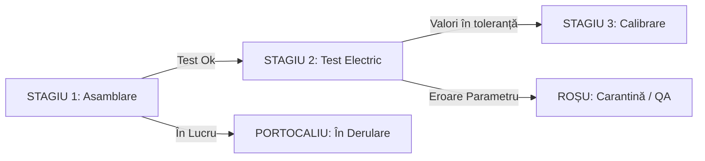

# SmartQMA — Visual Guidelines & Design System

Sistemul vizual SmartQMA este proiectat special pentru mediul industrial de producție (shop-floor, stații de asamblare, laboratoare de testare a calității și ecrane de control managerial).
Prioritățile cheie sunt: **lizibilitate maximă la distanță**, **contrast ridicat (conform WCAG 2.1 AA)**, **diferențiere imediată a stărilor produselor** și o estetică modernă, curată de tip **industrial-dark/light**.

---

## 🎨 Paleta Cromatică

Paleta este construită în jurul celor 4 culori fundamentale specificate: **Negru**, **Alb**, **Roșu** și **Portocaliu**, completate cu tonuri neutre de oțel/zinc pentru elemente structurale și date de laborator.

### 1. Culori Principale (Brand & Identity)

| Culoare | HEX | RGB | Rol Funcțional |
| :--- | :--- | :--- | :--- |
| **Pure / Deep Black** | `#09090B` | `9, 9, 11` | Fundal principal în modul întunecat (Dark Mode), bare de navigare, panouri de bord industriale. |
| **Surface Dark** | `#18181B` | `24, 24, 27` | Carduri, tabele de date, containere de stații de testare. |
| **Pure White** | `#FFFFFF` | `255, 255, 255` | Text primar pe fundal întunecat, suprafețe card în Light Mode. |
| **Off-White / Canvas** | `#FAFAFA` | `250, 250, 250` | Fundal curat pentru modul luminos de birou / laborator. |
| **Industrial Red** | `#DC2626` | `220, 38, 38` | Erori de testare, starea `FAILED`, alertă calitate, oprire linie (Andon), produse casate (`SCRAP`). |
| **Deep Red (Hover/Active)**| `#991B1B` | `153, 27, 27` | Stări apăsate, borduri de carantină critică. |
| **Quality Orange** | `#EA580C` | `234, 88, 12` | Stadiu în derulare (`IN_PROGRESS`), avertizare abatere parametri (`WARNING`), coadă de re-testare. |
| **Amber Orange** | `#F97316` | `249, 115, 22` | Badge-uri active, grafice de distribuție defecte, atenționări mentenanță stație. |

### 2. Tonuri Neutre & Structurale

| Token | HEX | Utilizare |
| :--- | :--- | :--- |
| `--gray-100` | `#F4F4F5` | Borduri subtile în Light Mode, fundaluri de hover |
| `--gray-300` | `#D4D4D8` | Separatoare tabele, text secundar în Light Mode |
| `--gray-500` | `#71717A` | Placeholder câmpuri de scanare, legende grafice |
| `--gray-700` | `#3F3F46` | Borduri carduri în Dark Mode, separatoare de flux |
| `--gray-900` | `#18181B` | Suprafețe secundare, dialoguri modale |

### 3. Culori Semantice de Stare (Product & Test States)



- 🔴 **FAILED / SCRAPPED**: Fundal `#450A0A` cu text `#F87171` și bordură `#DC2626`
- 🟠 **IN_TESTING / WARNING**: Fundal `#431407` cu text `#FDBA74` și bordură `#EA580C`
- ⚪ **IDLE / PENDING**: Fundal `#27272A` cu text `#E4E4E7` și bordură `#52525B`
- 🟢 **PASSED**: Fundal `#052E16` cu text `#4ADE80` și bordură `#16A34A` *(utilizat exclusiv pentru confirmarea succesului la bancul de probă)*

---

## 🔤 Tipografie (Typography)

Sistemul utilizează două familii de fonturi complementare:
1. **Font de Interfață**: `Inter` sau `Roboto` (sans-serif) — optimizat pentru lizibilitate la orice rezoluție.
2. **Font Monospace pentru Trasabilitate**: `JetBrains Mono` sau `Roboto Mono` — utilizat strict pentru:
   - Numere de serie (Serial Numbers, UUID)
   - Coduri de bare / QR / DataMatrix
   - Valori numerice ale măsurătorilor (volți, amperi, milimetri, temperaturi)
   - Timpi de execuție și timestamp-uri ISO 8601

### Scară Tipografică

| Nivel | Dimensiune | Greutate (Weight) | Linie (Line-height) | Utilizare |
| :--- | :--- | :--- | :--- | :--- |
| **Display H1** | 32px (2rem) | 700 (Bold) | 1.2 | Titluri principale panou comandă |
| **Section H2** | 24px (1.5rem) | 600 (SemiBold) | 1.3 | Nume stație de testare, fluxuri de producție |
| **Card H3** | 18px (1.125rem) | 600 (SemiBold) | 1.4 | Titluri carduri metrici, etape de producție |
| **Body Base** | 14px (0.875rem) | 400 (Regular) | 1.5 | Text general, etichete câmpuri |
| **Mono Data** | 13px (0.8125rem) | 500 (Medium) | 1.4 | Seriale piese, valori testare, JSON logs |
| **Small / Badge**| 12px (0.75rem) | 600 (SemiBold) | 1.2 | Stări produs, tag-uri operatori, timestamp-uri |

---

## 📐 Sistem de Spațiere (Spacing & Grid)

Scara de spațiere este bazată pe un multiplu de **4px** / **8px**:

| Token | Valoare | Utilizare |
| :--- | :--- | :--- |
| `--spacing-xs` | `4px` | Padding badge-uri, spațiu între icon și text |
| `--spacing-sm` | `8px` | Spațiu între câmpuri adiacente, padding butoane mici |
| `--spacing-md` | `16px` | Padding standard carduri, distanță între coloane |
| `--spacing-lg` | `24px` | Spațiere secțiuni, layout grid panou principal |
| `--spacing-xl` | `32px` | Separare module majore de ecran |
| `--spacing-2xl`| `48px` | Margini ecran întreg pe display industrial |

---

## 🧱 Componente de Bază & Exemple de Cod

### 1. Variabile CSS Globale (`smartqma-tokens.css`)

```css
:root {
  /* Culori Principale */
  --qma-color-black: #09090b;
  --qma-color-surface-dark: #18181b;
  --qma-color-surface-card: #27272a;
  --qma-color-white: #ffffff;
  
  /* Accente SmartQMA */
  --qma-color-red-primary: #dc2626;
  --qma-color-red-hover: #b91c1c;
  --qma-color-red-bg: rgba(220, 38, 38, 0.15);
  
  --qma-color-orange-primary: #ea580c;
  --qma-color-orange-hover: #c2410c;
  --qma-color-orange-bg: rgba(234, 88, 12, 0.15);
  
  /* Neutre */
  --qma-border-color: #3f3f46;
  --qma-text-muted: #a1a1aa;
  
  /* Fonturi */
  --qma-font-sans: 'Inter', -apple-system, BlinkMacSystemFont, sans-serif;
  --qma-font-mono: 'JetBrains Mono', 'Roboto Mono', monospace;
  
  /* Borduri & Raze */
  --qma-radius-sm: 4px;
  --qma-radius-md: 8px;
  --qma-radius-lg: 12px;
}
```

### 2. Badge de Stare Produs (Componentă Exemplu)

```html
<!-- Stare: FAILED (Roșu) -->
<span class="qma-badge qma-badge--failed">
  <svg class="qma-icon" viewBox="0 0 20 20" fill="currentColor">
    <path fill-rule="evenodd" d="M10 18a8 8 0 100-16 8 8 0 000 16zM8.707 7.293a1 1 0 00-1.414 1.414L8.586 10l-1.293 1.293a1 1 0 101.414 1.414L10 11.414l1.293 1.293a1 1 0 001.414-1.414L11.414 10l1.293-1.293a1 1 0 00-1.414-1.414L10 8.586 8.707 7.293z" clip-rule="evenodd" />
  </svg>
  REBUT TEST #04 (FAILED)
</span>

<!-- Stare: ÎN CURS (Portocaliu) -->
<span class="qma-badge qma-badge--in-progress">
  <span class="qma-pulse-dot"></span>
  TESTARE ELECTRICĂ ÎN DERULARE
</span>
```

```css
.qma-badge {
  display: inline-flex;
  align-items: center;
  gap: 6px;
  padding: 4px 10px;
  border-radius: var(--qma-radius-sm);
  font-family: var(--qma-font-mono);
  font-size: 12px;
  font-weight: 600;
  text-transform: uppercase;
  letter-spacing: 0.05em;
}

.qma-badge--failed {
  background-color: var(--qma-color-red-bg);
  color: #f87171;
  border: 1px solid var(--qma-color-red-primary);
}

.qma-badge--in-progress {
  background-color: var(--qma-color-orange-bg);
  color: #fdba74;
  border: 1px solid var(--qma-color-orange-primary);
}
```

### 3. Card Indicator de Randament / Stație (Metric Card)

```css
.qma-metric-card {
  background: var(--qma-color-surface-dark);
  border: 1px solid var(--qma-border-color);
  border-left: 4px solid var(--qma-color-orange-primary);
  border-radius: var(--qma-radius-md);
  padding: 16px;
  color: var(--qma-color-white);
}

.qma-metric-card--alert {
  border-left-color: var(--qma-color-red-primary);
}
```

---

## ♿ Accesibilitate & Standarde Industriale (WCAG 2.1 AA)

1. **Rata de Contrast**:
   - Textul primar pe fundal negru/întunecat atinge un raport de contrast de **minim 7:1** (depășește cerința standard de 4.5:1).
   - Elementele roșii și portocalii sunt însoțite obligatoriu de **iconițe și etichete textuale**, nu doar de culoare, pentru a preveni confuzia la persoanele cu deficiențe de percepție a culorilor.
2. **Operare prin Scanner & Tastatură**:
   - Toate ecranele de introducere a serialelor suportă focalizare automată (`auto-focus`) pe input pentru lucrul direct cu scannere de coduri de bare / QR handheld.
